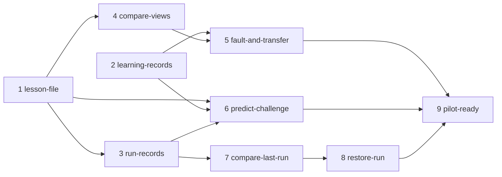

# Jumper: development plan, the circuit learning journey

| Item | Value |
| --- | --- |
| Date | November 21, 2026 |
| Status | Draft for review |
| Writing standard | ASD-STE100 Simplified Technical English |
| Technical scope | [TRD addendum](TRD-learning-journey.md) |
| Source | [Product requirements v0.1](sources/2026-11-20-learning-journey-prd.md) |

This plan does not change the original text of [PLAN.md](../PLAN.md) (assignment rule 2). Each feature below gets one row in the "Plan vs. Reality" table when its issue opens. Section 4 gives the text of these rows.

## 1. Rules for each feature

- One issue, one branch `feature/<name>`, one pull request with `closes #N` (house rules 1–3).
- The issue includes the user story. The user story comes from the new "Plan vs. Reality" row (assignment rule 1).
- The prompts go into `prompts/<name>.md` on the same branch (house rule 4).
- New pure code goes into `lib/` with Vitest tests (house rule 6). All text goes into `content/` (house rule 7).
- CI must pass before an approval or a merge. After the merge, the deploy must show the new version (agent hooks 3 and 4).
- A migration is a separate pull request. Apply it to production immediately after the merge (TRD section 11).

## 2. Work packages, in order

Size: **S** is less than 1 day, **M** is 1–2 days, **L** is 3–4 days, for one developer with Claude Code. These sizes come from the audit of November 21. They do not include the media and the review in section 3.

| # | Branch | Slice | Requirements | Size | Needs | Result that we can show |
| --- | --- | --- | --- | --- | --- | --- |
| 1 | `feature/lesson-file` | 0 | Lesson version, concept tags, supported changes, `connections.ts`, `observe.ts`, content tests | M | — | The test suite proves that the LED lesson gives the same observation for the same board and code. |
| 2 | `feature/learning-records` | 0 | Migration for `learning_attempts` and `learning_events`, RLS, SQL isolation test, server actions, `schema.md` | M | Decision D4 | Records save and only the owner reads them. |
| 3 | `feature/run-records` | 0 / 3 | F3-R1, F3-R2, F3-AC4: a record at each Run, keep three, result on the record, "Changed since this run" | M | 1 | Run, change a wire during the animation: the result stays with its record. |
| 4 | `feature/compare-views` | 1 | F1-R1 to F1-R4, F1-AC1, F1-AC2, F1-AC5: schematic, photo, linked selection, keyboard list, reference difference, phone tabs | L | 1, media M1 and M2 | Select pin 13 in any view: all three views show it. |
| 5 | `feature/fault-and-transfer` | 1 | F1-R5, F1-R6, F1-AC3, F1-AC4: fault clip with captions, first-check question, transfer photo question, records | M | 2, 4, media M3 and M4 | Same Circuit, Three Worlds works from start to end. |
| 6 | `feature/predict-challenge` | 2 | F2-R1 to F2-R6, all F2-AC: state machine, prediction lock, configuration check, two grades, hints, retry, variation | L | 1, 2, 3, content C1 | One student completes and retries a scored challenge. |
| 7 | `feature/compare-last-run` | 3 | F3-R3 to F3-R5, F3-AC1 to F3-AC3, F3-AC6: connection and code diff, both results, "candidate causes" text | M | 3 | The learner sees what changed between two runs. |
| 8 | `feature/restore-run` | 3 | F3-R6, F3-AC5: restore board and code together, undo of a restore, new run necessary | S | 3, 7 | The learner tests a diagnosis with a restore and a new run. |
| 9 | `feature/pilot-ready` | 4 | Section 9 of the TRD addendum, the release checklist, saved SQL for the measures, consent text, one Playwright check of the journey | M | 1–8, review R1 | Pilot students can complete the journey, and the records are usable. |

**Total:** about 15–22 days of build work. This agrees with the source document: estimates come after the audit, and the audit is done.

**Order.** Packages 1–3 are the base. Packages 4 and 5 (P1) come before 6 (P2), and 6 comes before 7 and 8 (P3). Package 6 can start before 4 and 5 are complete, while we wait for the photos.

## 3. Work that is not code

Code cannot make these items. Each item has an owner and a package that waits for it.

| ID | Item | Owner | Needed by |
| --- | --- | --- | --- |
| M1 | Build the real LED circuit on a real Uno and breadboard, the same as the lesson baseline. Take a photo from above. | Hanif | Package 4 |
| M2 | Draw the schematic as SVG, with an `id` on each terminal and each net | Claude draws it; Hanif and a lecturer check it | Package 4 |
| M3 | Build the same circuit in a different layout. Take a photo from above. | Hanif | Package 5 |
| M4 | Record a clip of 10–20 s: a loose wire makes the LED stop. Write the captions and a text description. | Hanif | Package 5 |
| C1 | Write the challenges: changes from the "Yes" list (TRD addendum section 4), choices, explanations, hints and a variation | Claude drafts; Hanif approves | Package 6 |
| R1 | A lecturer reviews the map, the answers, the explanations and the clip | Hanif finds the reviewer | Package 9 |
| P1 | Find 5–8 introductory EE students who recently had a circuit that did not work. Agree the transfer rubric before the pilot. | Hanif | After package 9 |

## 4. Rows for "Plan vs. Reality"

Add each row when its issue opens, with the status "Backlogged". Change the status to "Done" at the merge. The user stories come from the source document.

| # | Row text (Planned feature column) |
| --- | --- |
| 72 | **Lesson file for the LED level** (discovery, not in this plan). User story: As an introductory circuits student, I want to inspect the same circuit in schematic, virtual, and physical views so that I can relate electrical connections to the parts in front of me. (Base for this story: one versioned lesson with stable IDs.) |
| 73 | **Pilot records** (discovery, not in this plan). User story: As a student who made an incorrect prediction, I want a targeted explanation and another attempt so that I can correct the concept I misunderstood. (Base: each first attempt and retry is a separate record.) |
| 74 | **Run records** (discovery, not in this plan). User story: As a student debugging a circuit, I want to compare my current build with the previous run so that I can identify changes that may explain the new behavior. (Base: a record at each Run.) |
| 75 | **Compare views** (discovery, not in this plan). User story: As an introductory circuits student, I want to inspect the same circuit in schematic, virtual, and physical views so that I can relate electrical connections to the parts in front of me. |
| 76 | **Physical fault and transfer** (discovery, not in this plan). User story: As a student preparing for a lab, I want to examine a physical failure and choose what to check so that I can practice applying my virtual learning to real hardware. |
| 77 | **Predict, Build, Explain** (discovery, not in this plan). User stories: As a circuits student, I want to predict a change's effect before running it so that I can compare my reasoning with the observed behavior. As a student who made an incorrect prediction, I want a targeted explanation and another attempt so that I can correct the concept I misunderstood. |
| 78 | **Compare with last run** (discovery, not in this plan). User story: As a student debugging a circuit, I want to compare my current build with the previous run so that I can identify changes that may explain the new behavior. |
| 79 | **Restore a run** (discovery, not in this plan). User story: As a student testing a diagnosis, I want to restore a prior build and rerun it so that I can check whether reversing the change restores the expected behavior. |
| 80 | **Pilot ready** (discovery, not in this plan). User story: all stories in rows 75–79, checked for keyboard use, captions, phone layout and usable records. |

## 5. Definition of done for the journey

The release checklist of the source document (section 10) is the definition of done. Package 9 checks each item:

1. Each acceptance criterion passes through `/p/arduino-foundations/2`.
2. A lecturer reviewed the content (R1).
3. Reference media, the board and the lesson version stay correct after edits (tests in packages 1 and 4).
4. Failed runs, quick runs, a refresh, retries, restore and undo keep the state (tests in packages 3, 6 and 8).
5. Keyboard, text alternatives, captions and the phone layout work (package 9).
6. The records show first attempts, retries, hints and transfer answers separately (package 2 and the saved SQL).
7. Target students tried the lesson, and the team reviewed the results (P1).
