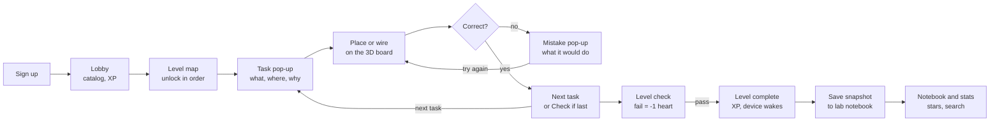
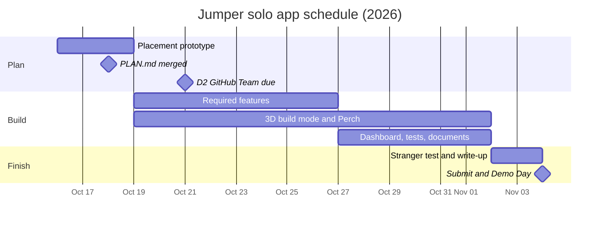

# Jumper: Product Requirements Document (PRD)

| Item | Value |
| --- | --- |
| Author | Hanif Ramadhan |
| Date | October 15, 2026 |
| Status | Approved for build |
| Writing standard | ASD-STE100 Simplified Technical English |
| Related document | [Technical Requirements Document (TRD)](TRD.md) |

## 1. Summary

Jumper is a web app. You use Jumper to learn hardware engineering. You connect real boards on a 3D breadboard, and the app guides you like a game.

For the Intro to Code solo app, Jumper has one project that you can play: **Perch**. The due date is November 4, 2026. A lobby shows all other projects and social features as "Coming soon".

**Pitch.** I am building Jumper, a web app where you learn how to wire boards and learn about hardware engineering, because I want to understand hardware without buying a bench full of parts. Jumper gives students many board options, for example Arduino and ESP32. Jumper guides students through hardware engineering, and it is always in their pocket.

The 3D breadboard is the main selling point of Jumper. You do not carry physical breadboards. In Jumper, you find all the hardware components that you need to build a real device. Jumper gives a set of classes, from foundations to real labs. You also get XP, you share your builds with friends, and you work with others on your next big project.

**Scope for the course.** The course release contains these items:

- The lobby
- Build mode with guided pop-ups
- The Perch project (5 levels on an ESP32-S3 board)
- Snapshots, stars and search
- A dashboard
- The two required tests

All work is digital. Jumper does not use physical hardware.

## 2. Problem, goals and non-goals

### 2.1 Problem

To learn hardware today, you must buy boards, parts and breadboards before you know what you need. Then you must carry them to each place where you practice. This is not flexible. Each mistake can also damage a part.

AI devices make this knowledge more valuable. Examples are Apple HomeView and the devices for the Meta Muse Gadgets SDK. But the cost to start has not decreased.

### 2.2 Goals

1. A learner can connect a full device on a 3D breadboard. The learner does not own or carry hardware. The learner can use a laptop or a phone.
2. Each connection teaches one thing. Pop-ups tell the learner what to do, where to do it, and why.
3. The work feels like a game. Jumper has levels, XP, hearts and instant feedback.
4. The parts and the pin assignments are the same as real hardware. Thus the skills are correct for real devices.
5. The app satisfies all required features of the solo app assignment.

### 2.3 Non-goals for this release

- Jumper does not run real firmware. Jumper checks connections only. It does not simulate electrical behavior.
- Jumper has only one project that you can play.
- Sharing, collaboration and more boards are not in this release. The app shows them as "Coming soon".

## 3. Users and use

The primary user is a beginner. This person wants to learn hardware engineering without a physical bench. Hanif is the first user. Hanif will use Jumper **3 times a week**.

| User | Need | What Jumper gives |
| --- | --- | --- |
| Beginner learner | To understand boards and connections without buying parts | Guided levels. Pop-ups explain each wire. |
| MBA or product student | To see how AI devices are built | Perch: a home for an AI agent, built step by step |
| Classmate at Demo Day | To try the app in two minutes | Sign up, open the lobby, complete Level 1 |

By the due date, the app must contain a minimum of 5 real entries of Hanif's own data. Each entry is one snapshot for one Perch level, with honest notes.

## 4. Product experience

A learner signs up and goes to the lobby. The learner selects a project. Then the learner completes the levels of that project in build mode. All projects use the same loop. Only the content is different.

### 4.1 Pop-ups

Pop-ups are the core of the learning. They are not decoration. Each pop-up tells the learner **what** to do and **where** to do it. The target pin and its holes glow. Each pop-up also tells the learner **why**.

Jumper has four types of pop-up:

| Pop-up | When it shows | Example |
| --- | --- | --- |
| Place | A part must go on the board. | "Put the button across the center gap. This keeps its pins apart." |
| Wire | The next connection is necessary. | "This is WS (word select). It tells the mic when to change between left and right audio. Connect it to GPIO 4." |
| Concept | An idea shows for the first time. | Power rails, pull-up resistors, I²S and SPI, in 2 or 3 sentences |
| Mistake | A wire is not correct. | "This wire connects 3.3 V to ground. Move it to the free hole of the GND pin." |

### 4.2 Rewards

- The learner gets XP for each task.
- The learner gets a bonus when a level has no mistakes.
- The learner loses a heart only when a level check fails.

## 5. Feature requirements

The table shows the features in the build sequence. Each feature has its own pull request, a linked issue and a saved prompt log. The plan merges first.

| # | Feature | User story | Type |
| --- | --- | --- | --- |
| 0 | Plan | PLAN.md merges before all feature pull requests. | Process |
| 1 | Sign up and log in | As a new visitor, I want to make an account, log in and log out, so that my builds are mine. | Required 1 |
| 2 | Data model | As the app, I want to keep users, projects, levels, tasks, sessions, snapshots, attempts and stars, with seed project data, so that each feature has a place for its data. | Required 2 |
| 2a | Lobby | As a learner, after I log in, I want a lobby. The lobby shows the project catalog, my XP and a "Continue" button to my current level. Projects and features that are not available show "Coming soon". | Lobby UI |
| 3 | 3D breadboard editor | As a learner, I want to click two holes to put a wire, a resistor or an LED on a 3D breadboard. When I move the pointer over a hole, I want to see all holes that connect to it. | My feature A |
| 4 | Module placement | As a learner, I want to put modules with many pins on the board, for example a button, a mic, an amplifier and a screen. | My feature A |
| 5 | Build mode with guided pop-ups | As a learner, in each project, I want a level map and one task at a time. A pop-up on the board shows where the part or wire goes, and why. Each wire gives a snap or a buzz. I get XP for each task. | My feature B |
| 5a | Level check | As a learner, at the end of a level, I push Check. I get a pass, or the specific cause of the failure. A failure costs a heart. The app saves each check. | My feature B |
| 6 | Snapshots | As a learner, I want to save my board with a title, a level and notes. I want to see a list of snapshots, open one in a 3D view, edit the notes, and delete it after a confirmation. | Required 3 |
| 7 | Validation | If I save without a title or a level, the app shows a clear message. The Check button is off when the board is empty. | Required 4 |
| 8 | Stars | As a learner, I want to star snapshots and see a Starred view. All stars are in one shared table. | Required 5 |
| 9 | Find | Search snapshot notes. Filter by level or by passed/failed. Sort by newest or by most mistakes. | Required 6 |
| 10 | Dashboard | Show levels completed, completed sessions, XP, first-try pass rate and a chart of my most frequent mistakes. | Required 7 |
| 11 | "It's alive" simulation | When a level passes, the device reacts. The LED flashes. The laptop mic moves a level meter. The browser speaks. The screen shows a face. | My feature C |
| 12 | Tests | Data isolation test and dashboard stat test, with red and green screenshots. | Required tests |
| 13 | Documents | schema.md and README.md | Required documents |

## 6. Launch content: the Perch project

Perch is the example project. It proves that build mode works. Perch is a desk device that gives an AI agent a home, with ears, a voice and a face. The learner connects it on an ESP32-S3-DevKitC-1 board across two 400-hole breadboards, in 5 levels. All other projects will use the same build mode with their own content.

| Level | What the learner connects | Required connections (ESP32-S3 pin → part) |
| --- | --- | --- |
| 1. Prepare the board | Two breadboards side by side. The ESP32-S3 sits across them. The rails get power. | 3V3 → + rail. GND → − rail. A jumper connects the rails of the two breadboards. |
| 2. Talk button and status light | Push button, 220 Ω resistor, LED | GPIO 1 → button → GND (internal pull-up). GPIO 2 → 220 Ω → LED + leg. LED − leg → GND. |
| 3. Ears | INMP441 I²S microphone | VDD → 3V3. GND → GND. L/R → GND. WS → GPIO 4. SCK → GPIO 5. SD → GPIO 6. |
| 4. Voice | MAX98357A amplifier and speaker | Vin → 3V3. GND → GND. SD → Vin. DIN → GPIO 7. BCLK → GPIO 15. LRC → GPIO 16. Speaker → amplifier + and −. |
| 5. Face | ST7789 1.54" SPI screen | VCC → 3V3. GND → GND. SCL → GPIO 21. SDA → GPIO 47. RES → GPIO 45. DC → GPIO 40. CS → GPIO 41. BLK → GPIO 42. |

Levels 3 to 5 use the published wiring of the Keyestudio ESP32-S3 breadboard AI chatbot kit ([source](https://docs.keyestudio.com/projects/ESP32S3_LCD154/en/latest/LCD154/LCD154.html)). The checks compare connections. They do not compare exact holes. Thus each correct layout passes.

**Example: Level 3 (Ears) tasks.** Each task opens its own pop-up. The first task also opens a Concept pop-up about I²S.

1. Put the INMP441 mic on breadboard B.
2. Connect VDD to the 3.3 V rail.
3. Connect GND to the GND rail.
4. Connect L/R to GND. This selects the left audio channel.
5. Connect WS to GPIO 4.
6. Connect SCK to GPIO 5.
7. Connect SD to GPIO 6.
8. Push Check.

## 7. Catalog and "Coming soon" items

At launch, only Perch is available. The app shows all other items with a "Coming soon" badge. The learner cannot start them. Thus users see the direction of Jumper, but they do not find dead ends.

| Item | Board | What it teaches | Status |
| --- | --- | --- | --- |
| Perch: a home for your AI agent | ESP32-S3 | Power, buttons, I²S audio in and out, SPI screen | Available |
| Arduino Foundations | Arduino Uno | Breadboard basics, Ohm's law, LEDs and buttons | Coming soon |
| Desk weather station | ESP32 DevKit V1 | Sensors, pull-up resistors, I²C screen | Coming soon |
| Plant-watering monitor | ESP32 DevKit V1 | Analog input, relays, power for a pump | Coming soon |
| Focus timer with buzzer | ESP32-C3 | PWM sound, buttons, LED patterns | Coming soon |
| Line-following robot | ESP32 DevKit V1 | Motor drivers, IR sensors, separate motor power | Coming soon |
| Share builds with friends | — | A Share button on each snapshot | Coming soon |
| Collaborate on a project | — | "Invite a collaborator" on the project page | Coming soon |

"Coming soon" is a status on each project. It is not separate code. To open a project later, add its levels and tasks, and change its status to available.

## 8. Data that the product keeps

The product keeps eight types of records. The [TRD](TRD.md) gives the exact columns, types and keys.

| Record | Contents | Who can see it |
| --- | --- | --- |
| User | Account and display name | Only that user |
| Project | Catalog card: title, board, status (available or coming soon) | All users |
| Level | The levels of a project, in sequence, and the connections that each level requires | All users |
| Task | The tasks of a level, in sequence: instruction, pop-up text, concept, target, XP | All users |
| Session | One sitting on a level: start time, end time, status (completed or abandoned), tasks done, mistakes, XP | Only its owner |
| Snapshot (main item) | A saved board: level, title, notes, wiring, passed or not, number of mistakes | Only its owner |
| Attempt | Each level check: passed or not, type of mistake | Only its owner |
| Star | One user puts a star on one snapshot. All stars are in one shared table. | Only its owner |

**Relationships.**

- A project has many levels.
- A level has many tasks.
- A user has many sessions, snapshots and attempts.
- Stars connect users and snapshots (many-to-many).

The browser saves the board in progress automatically. **Save snapshot** writes the board to the database.

**Sessions.** A session is one sitting on a level. A session is **completed** when all tasks are done and the level check passes. If the learner stops before that, the app saves the session as abandoned. Thus the dashboard can count completed sessions and show where learners stop.

## 9. Acceptance criteria and tests

The release is complete when these conditions are true:

- All required features work on the live URL.
- The app contains a minimum of 5 real entries.
- The two required tests pass, with red and green screenshots.

### 9.1 Required tests

1. **Data isolation.** Given User A saved a snapshot with the title "Ears wired", when User B logs in and opens the snapshot list or requests the snapshot of A by its ID, then the list of B is empty and the request returns "not found".
2. **Dashboard stat.** Given the first attempt of a user passed on Level 1, failed on Level 2 (and passed on the second attempt), and passed on Level 3, when the dashboard calculates the first-try pass rate, then it shows 67% (2 of 3 levels passed on the first attempt).

### 9.2 Acceptance checklist

- [ ] A new visitor can sign up, go to the lobby and start Perch Level 1, on a laptop or a phone.
- [ ] Each task shows a pop-up with what, where and why.
- [ ] A wrong wire shows a Mistake pop-up that explains the result.
- [ ] A failed level check gives the specific problem and costs a heart.
- [ ] The learner can make, see in 3D, edit, star and delete snapshots. Delete needs a confirmation.
- [ ] Search, filter and sort work on snapshots.
- [ ] The dashboard shows a minimum of one chart and 2 or 3 stats from real data.
- [ ] Projects and features that are "Coming soon" are visible, but the learner cannot start them.
- [ ] The repository has 9 or more merged pull requests. Each has an issue, a branch and a prompt log. No commits go directly to main.

## 10. Design direction

Jumper looks like an electronics workbench. It plays like Duolingo.

- **Look:** A cool gray bench mat and a realistic white breadboard. PCB green shows success and primary actions. Amber shows highlights and the "probe" hover.
- **Game feel:** Large buttons that move down when you push them. Hearts, XP and a level path, as in **Duolingo**.
- **Wiring:** The interaction is similar to **Wokwi** and **Tinkercad Circuits**.
- **Device faces:** The Perch screen is similar to **Apple HomeView**.
- **Type:** Bricolage Grotesque for the interface. IBM Plex Mono for pin labels.
- **Devices:** Laptop and phone. On a phone, the learner uses touch to connect wires. Tap a hole to start a wire. Tap a second hole to complete it. Pinch to zoom. Drag to turn the board. Pop-ups move to the bottom of the screen.

The [breadboard prototype](../reference/breadboard-prototype.html) shows the look and the interaction.

## 11. Risks, cuts and open questions

The largest risk is module placement together with checks for many pins. A screen has 8 pins, and one level checks many connections at the same time. We will make a prototype of this before feature 4.

| Risk | Mitigation |
| --- | --- |
| Module placement and checks for many pins take more time than planned. | Make a prototype first. The checks use data. Thus new levels add data, not code. |
| The app teaches an incorrect fact. | Each pop-up explanation and each level rule gives a source. |
| It takes time to write approximately 35 tasks with pop-up text. | Write Levels 1 to 3 first, and test the flow on them. Do not cut the pop-ups. |
| The browser does not give access to the mic. | Show an animated level meter. |
| 3D is slow on old laptops and phones. | Use the flat top-down view. It uses the same data and checks. |
| It is difficult to connect wires on a small touch screen. | Select a hole with a tap and zoom in automatically. Use larger tap targets. Move pop-ups to the bottom. Use the flat top-down view if necessary. |

### 11.1 Cut sequence if time is short

1. Live mic meter → animated meter.
2. Animated level map → a simple numbered list of levels.
3. Level 5 (Face) → release 4 levels.
4. 3D camera → flat top-down view.

### 11.2 Open questions

- If we match the pin map of a real firmware later, which pin does the talk button use? For now, it uses GPIO 1.
- Do we make the 3D parts from code shapes or load glTF models? The [TRD](TRD.md) gives the decision.

## 12. Milestones

PLAN.md merges by October 18. All features are complete by November 1. We submit and show the app on November 4.

The required features are sign-up, the data model, the lobby, snapshots, validation, stars and find. The group selects its Demo Day presenter by November 2.
