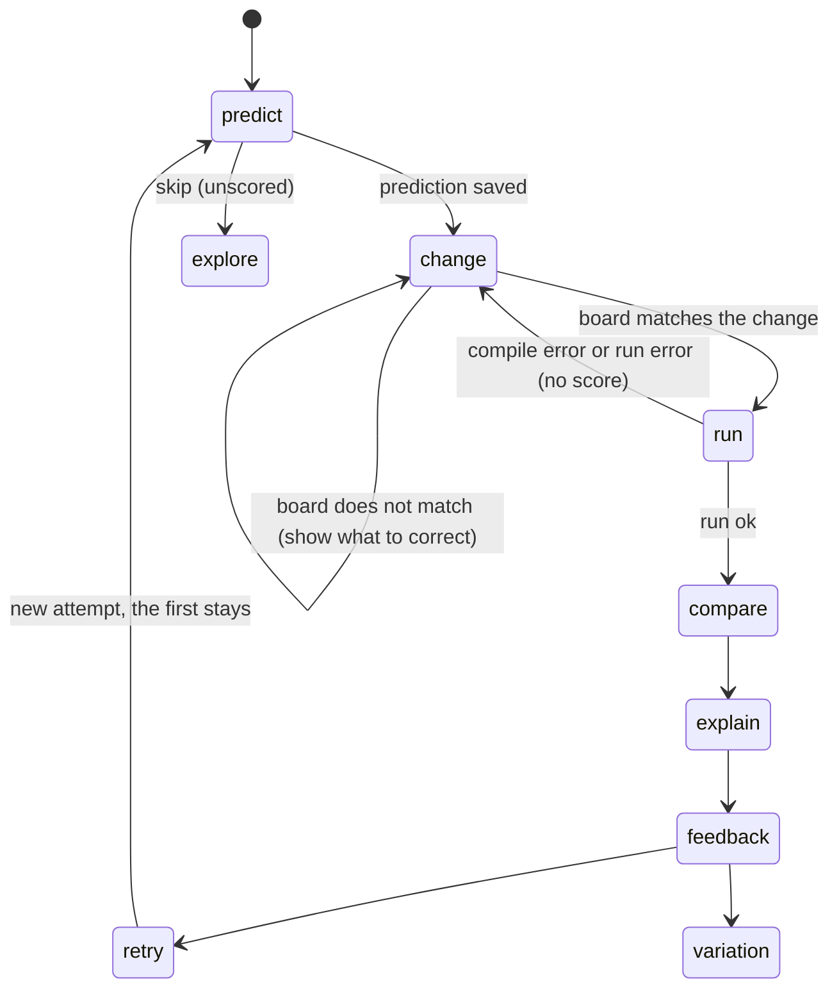

# Jumper: TRD addendum, the circuit learning journey

| Item | Value |
| --- | --- |
| Author | Hanif Ramadhan, with Claude Code |
| Date | November 21, 2026 |
| Status | Draft for review. Hanif must approve the decisions in section 12 before the build starts. |
| Writing standard | ASD-STE100 Simplified Technical English |
| Source | [Product requirements v0.1, November 20, 2026](sources/2026-11-20-learning-journey-prd.md) (interviews with 3 users of one persona) |
| Related documents | [TRD](TRD.md), [PRD](PRD.md), [PLAN.md](../PLAN.md), [development plan](PLAN-learning-journey.md) |

## 1. Summary

The source document asks for three features in one lesson:

| Priority | Feature | Short name in this document |
| --- | --- | --- |
| P1 | Same Circuit, Three Worlds | **Compare views** |
| P2 | Predict, Build, Explain | **Predict** |
| P3 | Circuit Change Replay | **Last run** |

This addendum does three things:

1. It compares the new requirements with the base plan (section 2).
2. It gives the results of the codebase audit (slice 0 of the source document) (section 3).
3. It sets the technical scope: what we build, what we reuse, what we do not build, and the decisions that Hanif must make.

The base [TRD](TRD.md) stays correct. This addendum adds to it. When the build is complete, we move the approved parts of this addendum into the TRD.

## 2. Comparison with the base plan

| Area | Base plan (PLAN.md, PRD, TRD) | New requirements | Effect |
| --- | --- | --- | --- |
| Users | The author and beginners who want to learn hardware (PLAN.md section 1). | Undergraduate students in an introductory circuits course, who recently failed to make a circuit work. Beginners stay in the long-term vision. | **Change of focus.** The interviews of November 18 (PLAN.md rows 70 and 71) already moved in this direction. Content must agree with university coursework. |
| First lesson | Perch on the ESP32-S3 (5 levels). Arduino Foundations was added later (rows 21 and 22). | One Arduino LED lesson. | **Reuse.** Arduino Foundations level 2 ("Light an LED") is this lesson. Perch does not change. |
| Physical world | "Everything is digital" (PLAN.md section 1). | A photo of the real build, a photo of a different layout, and a clip of a real fault. | **New.** The app shows real media for the first time. Somebody must build the real circuit and record it. Code cannot make this media. |
| Representations | One view: the 3D board. | Three views: schematic, 3D board, photo. A selection in one view shows the same point in the other two. | **New.** No schematic exists. The map between the views is new content. |
| Assessment | Hearts, XP, first-try pass rate, mistake types (PLAN.md sections 2 and 4). | Prediction accuracy, explanation accuracy, transfer, help used. First attempt and retry are separate records. | **New.** These measures are separate from hearts and XP. |
| Hints | The fail card says where the wrong wire goes (row 31), "Show me" (row 32), "Redo this step" (row 33), holograms (row 42), "Build it for me" (row 44), Step by step hints (row 50). | A ladder of authored hints that ends with a highlighted connection. Each hint is recorded. | **Reuse.** The hologram and the net glow give the highlight. The record of hint use is new. |
| Snapshots | The learner saves a snapshot by hand. It goes to the `snapshots` table, with a title and notes (row 6). | The app records each Run automatically, keeps the latest three, compares two of them, and restores one. | **New, with a name conflict.** In this addendum and in the code, an automatic record is a **run record**. The word "snapshot" stays for the lab notebook. |
| Undo | Undo and Clear for parts (rows 25 and 43). The sketch is not in the undo history. | Restore puts back the board **and** the sketch together. Undo of a restore puts back both. | **Change.** The board store needs one new action for board and sketch together. |
| Run | Run is in the code step of Arduino Foundations levels 2 and 4 (row 22). The goal check uses a virtual clock. | Each result stays with the exact state that started the run. | **Change.** The live run follows wire changes after Run (by design, in `components/build/sketch-panel.tsx`). Section 6.3 tells how a result stays with its run record. |
| Records | Sessions, attempts and snapshots in Supabase. The board autosaves in the browser. | Pilot records that a researcher can read for each student. | **New.** Two new tables (section 7). |

**Items in the source document that this scope does not build, and why:**

| Item | Reason |
| --- | --- |
| "Changed supported component values" (F3-R3) | The parts have no values. The checker uses logic levels only (section 4). A resistor value is a fact in the lesson text, not a value that the learner can change. |
| Automatic grading of free text | The source document also says: use authored choices. Written reflections are kept for review only. |
| A full timeline, playback of the run, and replay of old history | The source document puts these after the pilot. |
| Challenges about brightness, current or a burned LED | The simulator cannot show them (section 4). |

## 3. Audit results (slice 0)

The source document says that the codebase was not examined. This audit examined it on November 21, 2026.

| Need in the source document | What exists | File | Gap |
| --- | --- | --- | --- |
| One LED lesson with a fixed board, resistor, LED direction and code | Arduino Foundations level 2: Uno pin D13 → `r1` → `led1` → GND. The finished board is in content. The sketch has a starter, a solution, a blink goal and Step by step lines. | `content/projects/arduino-foundations.json`, `content/boards/arduino-foundations.json`, `content/sketches/arduino-foundations.json` | No lesson version number. No list of concept tags. |
| Stable IDs for parts, terminals and holes | Part IDs (`r1`, `led1`, `w3`), terminals (`r1.1`, `led1.anode`, `uno.D13`) and holes (`A-c22`, `A-L+5`). Nets come from union-find. | `lib/circuit/parts.ts`, `lib/circuit/nets.ts` | No list of connections (terminal to terminal) that is independent of the holes. A wire ID changes when the learner places the wire again. |
| Board serialization | `{ version: 1, parts }`, validated by Zod. | `lib/snapshots/wiring.ts` | None. Run records use the same format. |
| Run results | The parser gives a line and a code for each error. The runner stops a loop that does not wait (`MAX_STEPS`). `checkGoal` gives pass or fail with a reason and a line. `ledChanges` gives each LED change with its time. | `lib/sketch/parse.ts`, `run.ts`, `goal.ts` | No "observed behavior" value (off, on, blink). We add one pure function (section 6.2). |
| A result that stays with its state | The goal check is synchronous on a virtual clock, so it uses the board at the press of Run. The live LED animation uses the board as it is now. | `components/build/sketch-panel.tsx` | The animation can show a state that is not the run record. Section 6.3 solves this. |
| Restore and undo | Undo for parts (`history`). Clear and "Put back" are one undo step. | `lib/game/board-store.ts` | The sketch is not in the history. No backup slot. |
| Persistence | The board, the progress and the sketch save in `localStorage`, with a key for each user and level. Sessions and attempts go to Supabase. | `components/build/autosave.ts`, `lib/game/level-key.ts` | No run history. No records for predictions or explanations. |
| Schematic | Nothing. | — | New. |
| Physical media with hotspots | Nothing. Walkthrough videos are WebM, with captions as text in `content/videos.json`. | `components/walkthrough/` | New. The clip player does not use `<track>` captions. |
| Analytics events | Nothing. | — | New. |
| Phone layout | The board uses 60% of the screen. Side panels start closed. Pop-ups become a bottom sheet. | `lib/game/phone-layout.ts` | The compare views need a stacked layout. |

**Result of slice 0:** The LED circuit can be saved, run and restored with the same observation each time, after we add the work in section 6. No part of the existing runtime must be replaced.

## 4. What the simulator can show

The simulator is a **logic model**, not an electrical model (`lib/sketch/circuit.ts`):

- An LED lights when its + leg is on a HIGH net and its − leg is on a LOW net.
- A resistor joins two nets. It has no value.
- A pressed button joins its two sides.

Thus the challenges can use only changes that the model shows correctly:

| Change | Model result | Real result | Use in a challenge |
| --- | --- | --- | --- |
| Move the D13 wire to another pin (for example D12) | LED off (the sketch writes pin 13) | LED off | **Yes** |
| Remove the GND wire, or move it to an empty row | LED off (open circuit) | LED off | **Yes** |
| Turn the LED around | LED off | LED off | **Yes** |
| Move the LED − leg to the + rail | LED off | LED off | **Yes** |
| Put the resistor on the other side of the LED | LED blinks | LED blinks | **Yes** (the order of parts in series does not matter) |
| Change the sketch to `delay(100)` | LED blinks faster | LED blinks faster | **Yes** |
| Remove the resistor and join its holes with a wire | LED blinks | LED is too bright, and it can burn | **No.** The model teaches a wrong result. |
| A loose wire | Not possible (a wire is in or out) | The LED flickers or is off | **Only in the fault clip** (real media) |

**Rule:** Each challenge in `content/` names one change from the "Yes" rows. A content test fails when a challenge uses a change that is not on the list of supported changes.

## 5. The pilot lesson

| Field | Value |
| --- | --- |
| Lesson ID | `af-led` |
| Version | `1` |
| Level | Arduino Foundations level 2, through the normal level path (`/p/arduino-foundations/2`) |
| Board | Arduino Uno (`uno`) and breadboard A |
| Baseline circuit | The parts of `content/boards/arduino-foundations.json`, levels 1 and 2 |
| Baseline code | The `solution` lines of the level 2 sketch |
| Parts in the kit | Uno, one resistor (the value is a lesson fact. Proposal: 220 Ω), one red LED, 4 wires |
| Concept tags | `closed-loop`, `led-polarity`, `output-pin`, `breadboard-strips`, `series-order` |

The version number changes when the circuit, the code or the map changes. Each record keeps the lesson version (section 7).

## 6. Architecture additions

### 6.1 Content files (JSON, validated by Zod)

House rule 7 applies: all text is in `content/`. The new folder is `content/lessons/`.

```jsonc
// content/lessons/af-led.json
{
  "id": "af-led", "version": 1,
  "project": "arduino-foundations", "level": 2,
  "concepts": ["closed-loop", "led-polarity", "output-pin", "breadboard-strips", "series-order"],

  // RepresentationMap: one item for each terminal and each connection. The ID is the stable ID.
  "map": {
    "terminals": [
      { "id": "uno.D13", "label": "Pin 13",
        "schematic": "t-d13",                       // id of an element in the schematic SVG
        "photos": { "ref": { "x": 0.41, "y": 0.22 }, "layout2": { "x": 0.18, "y": 0.30 } } }
    ],
    "connections": [
      { "id": "c-d13-r1", "a": "uno.D13", "b": "r1.1",
        "schematic": "n-d13", "explain": "Pin 13 sends 5 V to the resistor. The 5 holes of this strip connect inside the breadboard." }
    ]
  },

  "media": {
    "schematic": "/lessons/af-led/schematic.svg",
    "photos": { "ref": { "src": "/lessons/af-led/ref.webp", "alt": "..." },
                "layout2": { "src": "/lessons/af-led/layout2.webp", "alt": "..." } },
    "fault": { "src": "/lessons/af-led/fault.webm", "captions": "/lessons/af-led/fault.vtt", "description": "..." }
  },

  "questions": [ /* the first-check question (F1-R5) and the transfer question (F1-R6) */ ],
  "challenges": [ /* ChallengeDefinition, section 6.4 */ ]
}
```

- The 3D board does not need anchors in the map. The terminal ID gives the hole through `endpointHole()` in `lib/circuit/nets.ts`.
- A hotspot on a photo is a fraction of the width and the height. Thus it stays correct at each screen size.
- The schematic is one SVG file that a person draws. Each terminal and each net has an `id` in the SVG. We do not add a schematic library.
- A content test makes sure that each terminal and connection in the map is in the baseline circuit, that each `schematic` ID is in the SVG, and that each hotspot is between 0 and 1.

### 6.2 New pure modules

These modules follow house rule 6: no React, no 3D code, no database code. Each function has Vitest tests.

| Module | Functions | What it does |
| --- | --- | --- |
| `lib/circuit/connections.ts` | `connectionsOf(bench, parts, terminals)`, `diffConnections(reference, current)` | Gives the terminal pairs that are on the same net. The result does not depend on the holes or the wire IDs. The diff gives `added`, `removed` and `moved` (one end the same, the other end different). |
| `lib/sketch/observe.ts` | `observeLed(program, circuit, led)` | Runs the sketch for 6 s of virtual time (as `checkGoal` does). Gives `{ kind: "off" }`, `{ kind: "on" }` or `{ kind: "blink", onMs, offMs }`. |
| `lib/runs/record.ts` | `captureRun()`, `keepLatest(records, 3)`, `diffRuns(before, after)`, `diffLines(a, b)` | Makes a run record. Keeps the latest three. Compares two records: connections (from `diffConnections`) and code lines. `diffLines` is a small longest-common-subsequence function (about 30 lines). We do not add a diff library. |
| `lib/challenge/machine.ts` | `challengeReducer(state, event)`, `grade(definition, answers, observed)` | The Predict state machine (section 6.4). It grades the behavior and the explanation separately. |
| `lib/journey/select.ts` | `linkedTargets(map, id)` | For a selected terminal or connection, gives the schematic ID, the photo hotspots, the 3D holes and the text. |

### 6.3 Run records (Last run, P3)

**Capture.** When the learner pushes Run, the app does these steps in this order, in one synchronous function:

1. Make a run record: `{ runId, lesson, version, runtime, at, parts, code }`. `runId` is `crypto.randomUUID()`. `runtime` is a constant in `lib/sketch/run.ts` (start at `"sketch-1"`). Change it when the runner behavior changes.
2. Parse and check the sketch against the parts **of the record**, not the parts in the store.
3. Attach the result to the record: `{ status: "ok", observed }` or `{ status: "error", error }`.
4. Start the live animation.

The goal check runs on a virtual clock in one call. Thus no other change can occur between step 1 and step 3, and F3-AC4 is true. The live animation continues to follow the board (the existing behavior). When the board or the code is different from the latest record, the panel shows "Changed since this run" next to the result.

**Storage.** The browser keeps the latest three records and one backup in `localStorage`, with the key of the level (`levelKey`) and the suffix `:runs`. Records do not go to the database. The reason: they contain the sketch, and the source document says that analytics must not contain source code. A `run_completed` event (section 8) goes to the database with the run ID and the result only.

**Compare with last run.** The panel shows the two latest records:

- If only one record exists, the panel says that another run is necessary (F3-AC1).
- Each connection change shows on the 3D board: the old end in grey, the new end in amber, with a text label (F3-AC2).
- Code changes show as lines with `+` and `−` and a text label, not only color.
- The panel lists each change. It says: "One of these changes can be the cause. Test your idea with a new run." It never names one cause (F3-AC3, F3-R5).
- A failed run shows its error next to its state. The learner can still compare and restore (F3-AC6).

**Restore.** A new board store action `restoreRun(record)`:

1. Saves the current parts and code into the backup slot (also changes that are not saved).
2. Sets the parts and the code from the record in one `set()` call. Thus the board and the code always change together.
3. Clears the result. The panel asks for a new run.

`undoRestore()` puts back the backup (parts and code together) (F3-AC5). The existing `undo()` does not change.

### 6.4 Predict (P2)

**ChallengeDefinition** (in `content/lessons/af-led.json`):

```jsonc
{
  "id": "move-gnd", "concept": "closed-loop",
  "baseline": "lesson",                                   // starts from the lesson baseline
  "change": { "kind": "move_end", "connection": "c-led-gnd", "to": "A-L+5",
              "text": "Move the end of the GND wire from the − rail to the + rail." },
  "predict": { "options": ["blinks", "stays on", "stays off"], "expected": "stays off" },
  "explain": { "options": [ { "text": "...", "correct": true, "feedback": "..." }, { "text": "...", "correct": false, "feedback": "..." } ] },
  "hints": ["...", "...", { "highlight": "c-led-gnd", "text": "..." }],
  "variation": "move-gnd-layout2"                          // a challenge with its own circuit and map
}
```

**States:**



- **Prediction first (F2-R2, F2-AC1).** The Run button of the challenge is off until the prediction is saved or the learner pushes Skip. Skip makes an attempt with `scored = false`.
- **Configuration check (F2-R3).** Before the grade, `diffConnections(expectedBoard, board)` must be empty. If it is not empty, the panel tells which connection to correct. It does not grade.
- **Errors (F2-AC3).** A compile error or a run error gives a message and Retry. The attempt keeps `status = "error"` and no score.
- **Two grades (F2-R4, F2-AC4).** `grade()` gives `behaviorCorrect` and `explanationCorrect`. A correct behavior with a wrong explanation shows "Your explanation needs review".
- **Retry (F2-R6, F2-AC5).** A retry makes a new attempt with `kind = "retry"` and the ID of the first attempt. The first attempt does not change.
- **Variation (F2-AC6).** The variation has its own board and map. Its grade uses only its own definition.
- **Hearts and XP.** Proposal: a challenge does not take hearts. A first scored attempt gives XP one time. Decision D6 in section 12.

### 6.5 Compare views (P1)

- **Entry.** A "Compare views" button in build mode, on level 2 of Arduino Foundations only (the level has a lesson file). The release checklist needs the normal lesson entry point.
- **Laptop.** Three columns: schematic, 3D board, photo. The schematic and the photo have the label "Reference".
- **Phone.** One view at a time, with tabs. The selection stays when the learner changes the tab (F1-R1).
- **Selection (F1-R2, F1-AC1).** A click, a tap or the keyboard (Tab, then Enter) on a terminal or a connection, in any view, selects its ID. `linkedTargets()` gives the outline in the schematic, the ring on the photo and the net glow on the 3D board (the existing `hover` net glow). A label and the authored text show (F1-R3). A list of all terminals and connections, as buttons, gives the same selection without a pointer.
- **Difference from the reference (F1-R4, F1-AC2).** `diffConnections(lessonBaseline, board)` marks each changed connection on the 3D board and in the list. The schematic and the photo do not change.
- **Fault clip (F1-R5).** A `<video>` with a `<track kind="captions">` (WebVTT) and a text description under it. Then the first-check question.
- **Transfer (F1-R6, F1-AC4).** The second photo (a different layout) with its own hotspots. The answer key uses connection IDs, not positions. Thus a different position with the same connection is correct.
- **Media failure (F1-AC5).** Each image and video has an `onError` handler. It shows Retry and the text alternative. The board and the answers stay.

### 6.6 Files that change

| File | Change |
| --- | --- |
| `components/build/sketch-panel.tsx` | Run makes a run record first (section 6.3). "Changed since this run" label. |
| `lib/game/board-store.ts` | New actions `restoreRun` and `undoRestore`, and the backup slot. |
| `components/build/build-view.tsx` | The "Compare views", "Challenge" and "Compare with last run" buttons, when the level has a lesson file. |
| `lib/content/schema.ts`, `lib/content/load.ts` | Zod schema and reader for `content/lessons/`. |
| `components/journey/` (new) | Schematic view, photo view, linked list, fault clip, challenge panel, run compare panel. |
| `content/ui/journey.json` (new) | The text of the new screens. |
| `public/lessons/af-led/` (new) | Schematic SVG, two photos, fault clip, captions. |

## 7. Data and storage

**Decision proposal (D4):** pilot records go to Supabase, so that a researcher can read them for each student. Run records stay in the browser.

Two new tables. One migration. Row-level security as on the other user tables (`user_id = auth.uid()`). `schema.md` gets the new tables and the comparison with PLAN.md section 3 (assignment rule 6).

| Table | Columns (type) | Keys | Notes |
| --- | --- | --- | --- |
| `learning_attempts` | id (uuid), user_id (uuid), lesson_id (text), lesson_version (int), item_id (text: question or challenge ID), kind (text: first, retry or variation), first_attempt_id (uuid, nullable), scored (bool), status (text: open, error, complete), prediction (text, nullable), behavior_correct (bool, nullable), explanation (text, nullable), explanation_correct (bool, nullable), hints_used (int), reflection (text, nullable), run_id (uuid, nullable), created_at, completed_at (timestamptz) | PK id. FK user_id → profiles. FK first_attempt_id → learning_attempts. Unique (user_id, lesson_id, lesson_version, item_id) where kind = 'first' | The first answer and the final answer of the transfer question are separate fields of one row (F1-R6). The unique index keeps one first attempt for each item and lesson version. |
| `learning_events` | id (uuid, made in the browser), user_id (uuid), name (text), lesson_id (text), lesson_version (int), attempt_id (uuid, nullable), run_id (uuid, nullable), data (jsonb: IDs and scores only), created_at (timestamptz) | PK id. FK user_id → profiles | The browser makes the ID. Thus a second send of the same event does nothing (`on conflict do nothing`). |

- **Server actions** (`app/actions/journey.ts`): `saveAttempt`, `completeAttempt`, `logEvents` (a batch). Zod checks each input. `data` must not contain code or reflections: the Zod schema allows only numbers, booleans and IDs.
- **Duplicate results.** A result with a `run_id` that is already recorded does nothing (F3 "discard duplicate result processing").
- **Old data.** When a stored record has a different `lesson_version` or `runtime`, the app says that the lesson changed and offers a new attempt. The old row stays.
- **Tests.** An SQL test in `supabase/tests/` proves that user B cannot read the rows of user A in both tables, and that `anon` cannot read them.

## 8. Analytics events

The events go to `learning_events`. No new analytics service.

| Event | When | Fields in `data` | One time only |
| --- | --- | --- | --- |
| `comparison_opened` | Compare views opens | `view` | No |
| `connection_selected` | A selection in a view | `id`, `view` | No |
| `prediction_submitted` | A prediction is saved | `option`, `scored` | Yes, for each attempt |
| `run_completed` | A run gives a result | `status`, `observed` | Yes, for each run ID |
| `explanation_submitted` | An explanation is saved | `option`, `correct` | Yes, for each attempt |
| `hint_used` | A hint opens | `level` (1, 2, 3) | No |
| `snapshot_compared` | Compare with last run opens | `changes` (count) | No |
| `snapshot_restored` | A run record is restored | `from_run_id` | No |
| `transfer_completed` | The transfer question has its final answer | `first_correct`, `final_correct`, `hints_used` | Yes, for each attempt |

The source document names `snapshot_compared` and `snapshot_restored`. We keep these names for the researcher, but the UI says "run".

The measures of section 7 of the source document come from these two tables with SQL. Debugging efficiency is the time and the number of edits between the fault and a run that passes. The edit count comes from the `changes` field.

## 9. Accessibility and reliability

- Each view works with the keyboard. The linked list of terminals and connections is the text alternative of the visual map.
- A change never uses color only. It also uses a text label, an outline or a dash pattern.
- The clip has WebVTT captions and a text description. Animations stop when `prefers-reduced-motion` is set.
- A media, run or save failure never deletes the board, the code or the answers. A failed save tries again at the next action and shows a short message.
- Response time: the existing goal check runs 6 s of virtual time in one call. We measure the time of `observeLed` and `diffRuns` in the first pull request. The target is less than 50 ms on a mid-range phone.

## 10. Tests

| Test | Type | What it proves |
| --- | --- | --- |
| `tests/connections.test.ts` | Unit | The same circuit in different holes gives the same connections. A moved wire gives one `moved` item with the old and new ends. |
| `tests/observe.test.ts` | Unit | The baseline blinks 500/500. Each "Yes" change in section 4 gives the expected result. |
| `tests/run-record.test.ts` | Unit | A record does not change when the board changes after Run. Only three records stay. `diffLines` and `diffRuns` list each change. |
| `tests/restore.test.ts` | Unit | Restore changes the board and the code together. Undo of a restore puts back the unsaved state. |
| `tests/challenge.test.ts` | Unit | Run is locked before a prediction. Skip is unscored. An error gives no score. Two grades. A retry keeps the first attempt. |
| `tests/lesson-content.test.ts` | Unit | The lesson file agrees with the board, the SVG and the list of supported changes. |
| `supabase/tests/learning_isolation.sql` | SQL | Row-level security on the two new tables. |

## 11. Dependencies

**No new package.** The schematic is a hand-drawn SVG. The diff is a small function. The captions use the browser `<track>` element. Analytics use Supabase. Thus house rule 8 needs no approval.

## 12. Decisions for Hanif

| ID | Decision | Proposal | Why |
| --- | --- | --- | --- |
| D1 | Pilot lesson | Arduino Foundations level 2, version 1, as in section 5 | It exists, it has Run, and it is the LED circuit of the source document. |
| D2 | Resistor value in the lesson and the real build | 220 Ω | A common value for a red LED on 5 V. It is text only (section 4). |
| D3 | Who makes the physical media | Hanif builds the real circuit, takes the two photos, and records one loose-wire clip | The assignment does not allow placeholder content (assignment rule 7). |
| D4 | Persistence | Attempts and events in Supabase. Run records in the browser. | Researchers need the attempts for each student. Run records contain code. |
| D5 | How a researcher reads the records | Hanif runs saved SQL in the Supabase dashboard | A new export script needs `SUPABASE_SECRET_KEY`. CLAUDE.md allows that key only for the seed script and CI. |
| D6 | Hearts and XP in a challenge | No hearts lost. XP one time for the first scored attempt. | A lost heart can make a learner skip the prediction. Hearts stay for the level Check. |
| D7 | Phone | Compare views and Last run work on a phone. Predict works on a phone too, because the board already works there. | The phone build mode exists (row 57). |
| D8 | Subject review and consent | A lecturer reviews the map, the answers and the clip. The pilot shows a short consent text before the first record. | Release checklist item 2. Students give written reflections. |
| D9 | Name of the automatic record in the UI | "Run" ("Compare with last run") | "Snapshot" is the lab notebook (row 6). |

## 13. Risks

| Risk | Mitigation |
| --- | --- |
| A challenge teaches a wrong result, because the model is logic only | The list of supported changes (section 4) and a content test. Subject review (D8). |
| The real photos are late | Build slice 1 with the schematic and the 3D board first. The photo view comes last in that slice. |
| A hotspot is in the wrong place on a different screen size | Hotspots are fractions. A test checks the range. A person checks on a phone. |
| The `localStorage` space is full | Three records of one small board are less than 20 KB. If a save fails, the run still works, and the panel says that the history is not saved. |
| Scope growth | One lesson only. Perch does not change. |
