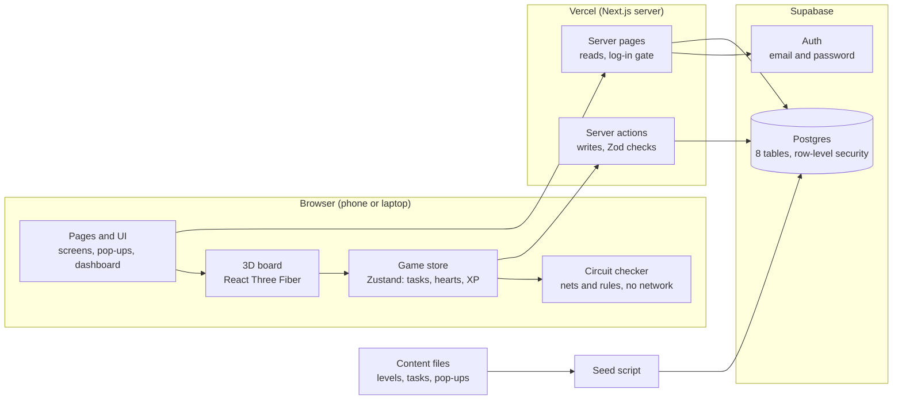
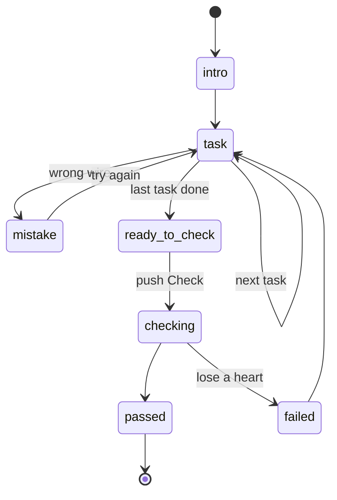
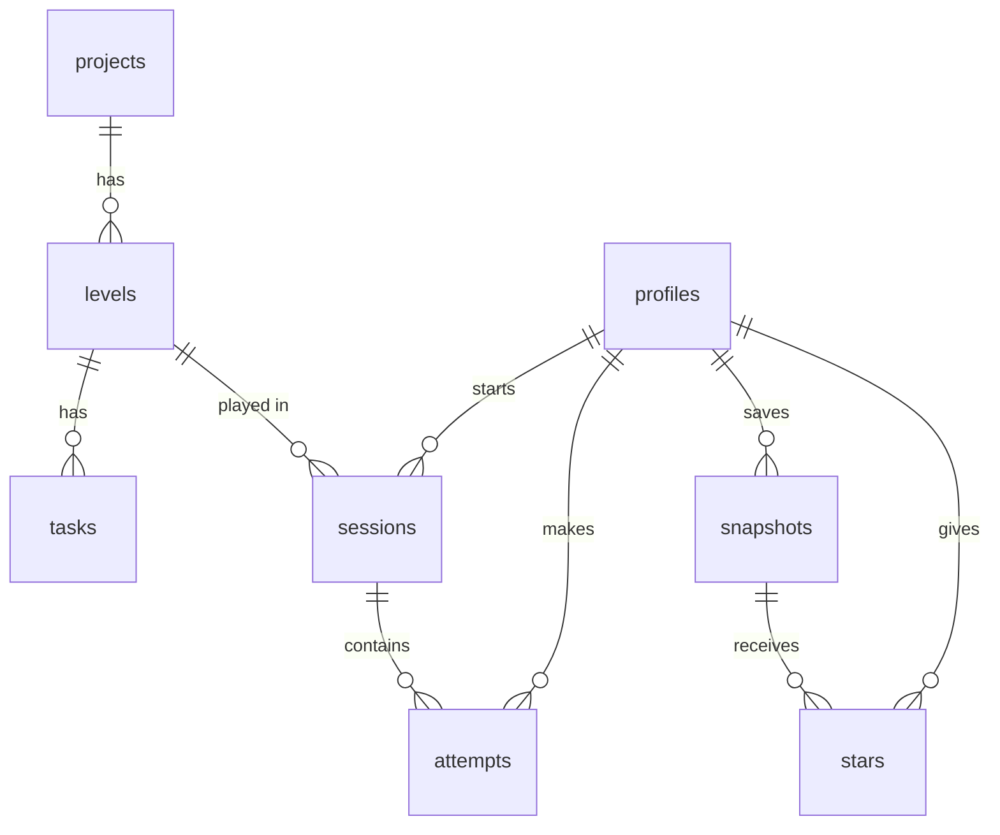

# Jumper: Technical Requirements Document (TRD)

| Item | Value |
| --- | --- |
| Author | Hanif Ramadhan |
| Date | October 15, 2026 |
| Status | Approved for build |
| Writing standard | ASD-STE100 Simplified Technical English |
| Related document | [Product Requirements Document (PRD)](PRD.md) |

## 1. Summary

Jumper is a Next.js app on Vercel. React Three Fiber draws the 3D board in the browser. Supabase gives the log-in function and a Postgres database. This document tells how to build the product in the [PRD](PRD.md).

### 1.1 Key decisions

1. **The circuit checker is a pure TypeScript module.** It does not contain 3D code or database code. It runs in the browser and gives instant feedback. It is easy to test.
2. **Projects, levels and tasks are data, not code.** They are JSON files in the repository. A script loads them into the database. Thus a new project does not need new game code.
3. **Row-level security in Postgres protects each table that users own.** Thus each user sees only their own data, even if the app code has a bug.
4. **Code shapes make the 3D parts.** We use boxes, cylinders and tubes with printed pin labels, as in the prototype. The launch does not need Blender or model files. We can add glTF models later.
5. **One codebase supports laptops and phones.** Touch input for wiring is a primary function.

## 2. Architecture

The browser runs the game and checks each wire immediately. The server reads and writes the database for the user.



- A tap on the 3D board goes to the game store. The store asks the circuit checker after each change.
- Server pages read levels and lists. They also stop users who are not logged in.
- Server actions save sessions, attempts and snapshots.
- The seed script loads the content files from the repository into Postgres.

## 3. Stack

Each layer uses a standard tool with a free tier. Claude Code knows these tools well.

| Layer | Choice | Reason | Alternative that we examined |
| --- | --- | --- | --- |
| Coding agent | Claude Code (Fable for large builds, Opus for plans and reviews) | It works across many files and keeps a clean prompt log for each feature branch. | Replit Agent |
| Framework | Next.js (App Router) with TypeScript | Pages, server code and API are in one project. It works well on Vercel. | Vite and a separate API |
| 3D | three.js through React Three Fiber, with the drei helper library | 3D parts are React components. drei gives camera controls, `Html` pop-ups and glTF loading. | Plain three.js (as in the prototype) |
| Game state | Zustand store | A small, fast store. The 3D scene and the UI both read it. | Redux, XState |
| Styles | Tailwind CSS with design tokens from the prototype | An agent writes it quickly. Tokens keep the light and dark themes the same. | CSS modules |
| UI components | shadcn/ui, on Radix UI and Tailwind CSS | The components go into the repository as source code. Thus we can change them. They give accessible forms, dialogs, sheets and toasts. | Hand-written components |
| Charts | Recharts | Simple React charts for the dashboard | Chart.js |
| Validation | Zod | One schema checks forms and the JSON for wiring and rules. | Checks written by hand |
| Authentication | Supabase Auth, email and password, through `@supabase/supabase-js` and `@supabase/ssr` | Users sign up in the app. `@supabase/ssr` keeps the session in cookies, so server pages and `proxy.ts` can read it. The live Demo Day sign-up needs this. | Auth.js |
| Database | Supabase Postgres with row-level security | Real tables and foreign keys. The database enforces data isolation. | SQLite and Prisma |
| Hosting | Vercel | Free. It makes a preview URL for each pull request and deploys production when a pull request merges to main. | Replit, Render |
| Tests | Vitest (unit and integration), plain SQL files for the database functions. Playwright is a dev package only. | Fast TypeScript tests. The SQL tests run on a local Postgres. Playwright records the walkthrough videos (`scripts/record-videos.ts`). The end-to-end suite is not built (section 10). | Jest |
| CI | GitHub Actions | It runs lint and tests on each pull request. | Vercel checks only |
| Code editor | CodeMirror 6 (`codemirror`, `@codemirror/lang-cpp`, `@codemirror/state`, `@codemirror/view`, `@codemirror/language`, `@lezer/highlight`) | The learner writes the Arduino sketch of a level in it: C++ colors, line numbers, and a mark on the line of a mistake. It is small, and it works with touch on a phone. Hanif approved it on October 23, 2026 (issue #58). | Monaco Editor, a plain text area |
| Browser APIs | Web Audio (mic meter), Speech Synthesis (voice), Vibration (phone haptics, where available) | They make the "It's alive" simulation without other services. | A third-party text-to-speech service |

## 4. App structure

The app has 15 routes: 13 pages and 2 route handlers. `proxy.ts` in the repository root checks the Supabase session on each request. Next.js 16 calls this file a proxy. Earlier versions called it middleware. It does not run for static files (images, `.webm` videos, the favicon and the manifest).

**Log-in rule.** The functions `needsLogin()` and `isVisitorPage()` in `lib/auth/rules.ts` set the rule. The proxy also refreshes the session cookie on each request.

- A visitor with no session goes to `/login`, unless the path is `/`, `/login`, `/signup`, `/forgot-password` or `/auth/callback`. These five paths are public.
- A user who is logged in goes to `/lobby` when they open `/`, `/login`, `/signup` or `/forgot-password`.
- `/reset-password` is not public. The link in the reset email logs the user in through `/auth/callback`. Then the user can set a new password.
- Each protected page also checks the user on the server. It sends a user with no session to `/login`, or shows "not found".

| Route | Screen | Log-in necessary |
| --- | --- | --- |
| `/` | Landing page for visitors: what Jumper is, the 3D board, the intro clip and the catalog | No (a user who is logged in goes to `/lobby`) |
| `/login`, `/signup` | Account forms | No (a user who is logged in goes to `/lobby`) |
| `/forgot-password` | Form that sends a password reset email | No (a user who is logged in goes to `/lobby`) |
| `/reset-password` | Form for a new password. It opens from the reset email. | Yes (the link makes the session) |
| `/auth/callback` | Route handler. It swaps the one-time code of an email link for a session. Then it goes to the `next` path (only a path in the app; the default is `/lobby`). If the code is not good, it goes to `/login?error=link`. | No |
| `/lobby` | Project catalog, XP, Continue button, "Coming soon" cards | Yes |
| `/play` | Route handler. It is the Build button of the dock. It goes to the level that the Continue button opens, or to `/lobby`. | Yes |
| `/profile` | Email, XP and join date. Change the display name and the character. Change the password. Log out. | Yes |
| `/p/[project]` | Level map for one project | Yes |
| `/p/[project]/[level]` | Build mode: 3D board, pop-ups, Check | Yes |
| `/p/[project]/[level]/complete` | Level complete screen for the latest completed session of the level | Yes |
| `/snapshots` | List with search, filters, sort and the Starred view | Yes |
| `/snapshots/[id]` | 3D view of the board (read only), edit notes, delete | Yes |
| `/dashboard` | Stats and the mistakes chart | Yes |

The app also has `app/manifest.ts`. It makes the web app manifest (`/manifest.webmanifest`) for installation on a phone. It is not a page.

### 4.1 Folders

```
app/            routes above, and server actions in app/actions/
  actions/      attempt, auth, profile, session, snapshot, star (section 9)
components/
  art/          pictures made from code: Volt (the mascot), Perch, board art
  auth/         account form, Log out form
  build/        build mode: view, task list, pop-ups, guide bar, code step (sketch panel and editor),
                Level complete, Check, autosave
  dashboard/    mistakes chart
  landing/      3D board of the landing page
  profile/      profile forms (name, character, password)
  scene/        build-scene (Canvas, camera, input), parts, modules, uno (Arduino Uno), textures
  snapshots/    snapshot page, save form, find form, star button
  ui/           shadcn/ui parts: badge, button, input, label
  walkthrough/  clip player and Watch button
  (root)        backdrop, card-row, device-tag, dock, lobby-cards, logo, turn-upright
lib/
  auth/         log-in rule, redirect rule and Zod schemas of the account forms (pure)
  circuit/      parts registry, bench, net builder, modules, level check (pure TypeScript)
  content/      readers of content/ files, and the Zod schema of the content
  game/         Zustand stores (board, sketch), task engine, hearts, level map, Continue target,
                mascot pose, walkthrough clips, autosave keys, check flow
  profile/      Zod schema of the profile form
  sketch/       Arduino sketch reader, runner and goal check (pure TypeScript)
  snapshots/    snapshot wiring format, search and filter URL, forms, stars
  stats/        dashboard calculations and Level complete numbers (pure TypeScript)
  supabase/     browser and server clients
  device.ts     phone or laptop, and WebGL check
  utils.ts      class name helper
content/
  benches/      the bench of a project: breadboards and main board (perch.json, arduino-foundations.json)
  boards/       a finished board for each level, in task order (perch.json, arduino-foundations.json)
  parts/        pin layouts for each part (ESP32-S3, Arduino Uno, INMP441, MAX98357A, ST7789, push button)
  projects/     one file for each project, with levels, tasks, pop-up text and sources.
                Four of them are "Coming soon" cards
  sketches/     the code step of a level: starter code, goal and hints
  ui/           the text of the screens: site, landing, build, complete, dashboard, profile, avatars,
                mascot, sketch, snapshots, walkthrough
  features.json the "Coming soon" feature cards of the lobby
  videos.json   the walkthrough videos: names, titles and captions
public/
  avatars/      the 5 profile characters (SVG)
  videos/       the recorded walkthrough videos (WebM, one for each size)
scripts/        record-videos.ts: records the walkthrough videos again (npm run videos)
supabase/
  migrations/   SQL for tables, row-level security and functions
  tests/        SQL tests that run on a local Postgres (section 10)
  seed.ts       loads content/projects/ into the projects, levels and tasks tables
tests/          Vitest unit and integration tests
docs/           PRD.md and TRD.md
ledger/         the project ledger (LEDGER.md) and the raw logs
prompts/        the key prompts and the pull request text of each feature
reference/      breadboard-prototype.html
.claude/        agent hooks and settings
.github/workflows/  CI (ci.yml)
proxy.ts        the log-in rule for each request (the old name was middleware)
```

## 5. 3D scene and input

The scene is a React Three Fiber `<Canvas>`. It reads the board from the Zustand store and draws it. The scene does not decide if a wire is correct.

### 5.1 Rendering

- **Breadboards:** Each breadboard is a box with a canvas texture on the top. The texture shows row letters, column numbers and rail lines. The 400 holes of a breadboard are one instanced mesh. Thus more than 800 holes use one draw call for each breadboard.
- **Parts:** Code shapes make all parts. A wire is a tube along a curve. Resistors and LEDs are cylinders with legs. Modules (ESP32-S3, mic, amplifier, screen) are boxes with a printed silkscreen texture. Pin headers go to the positions in the pin layout of the part in `content/parts/`.
- **3D models:** The launch does not need Blender or glTF. If a part needs a detailed model later, export it from Blender, or download it, as glTF. Load it with the `useGLTF` function of drei. The pin layout file continues to set the pin positions.
- **Render on demand:** The canvas draws again only when a change occurs (`frameloop="demand"`). This saves battery power on phones.

### 5.2 Selection and input

- The app separates a tap or click from a camera drag. A tap moves less than 6 px and takes less than 600 ms.
- A ray from the pointer hits the board plane. The app selects the nearest hole within half of the hole pitch.
- **Laptop:** Drag with the left button to turn the board. Drag with the right button to move it. Scroll to zoom. When the pointer is on a hole, all holes in the same connection glow.
- **Phone:** Drag with one finger to turn the board. Pinch with two fingers to zoom and move. Phones do not have a hover state. Thus the first tap on a hole shows its connections and selects it. Tap targets are larger. The camera zooms to the selected hole automatically.
- A flat top-down camera is always available as a fallback. It uses the same scene and data.

### 5.3 Pop-ups

- **Laptop:** The drei `Html` component attaches the pop-up to the target pin in 3D, with a line to the pin. The target holes glow.
- **Phone:** The pop-up is a sheet at the bottom of the screen. Thus it does not cover the board. The target holes continue to glow.
- The pop-up text comes from the task record (`instruction`, `popup_why`, `concept`). Do not write pop-up text in the code.

## 6. Build-mode engine and circuit checker

The engine is a small state machine in the Zustand store. The checker is a set of pure functions. The engine calls the checker after each change.

### 6.1 Engine states



Each transition updates the counters of the session: tasks done, mistakes and XP.

### 6.2 How the checker works

1. Each breadboard defines which holes connect. Each half-column of 5 holes is one strip. Each rail is one strip along its full length.
2. Each part on the board maps its pins to holes. It uses its pin layout. For example, the `WS` pin of the mic goes to hole `B-c14`.
3. Wires join strips with a union-find algorithm. The result is a list of **nets**. A net is a group of holes that have an electrical connection.
4. A **task** passes when its target connection exists. For example, the mic `WS` pin and the ESP32 `GPIO4` pin are on the same net.
5. The checker compares a wrong wire with the **forbid** rules of the level. Examples are a short to ground, power to power, and a reversed LED. The result selects the text of the Mistake pop-up.
6. The **level check** passes when all `require` rules are true and no `forbid` rule is true.

### 6.3 Data formats

Zod validates these formats.

```jsonc
// snapshot.wiring
{
  "boards": ["bb400-A", "bb400-B"],
  "parts": [{ "id": "mic1", "type": "inmp441", "at": "B-c12", "rot": 0 }],
  "wires": [{ "id": "w1", "from": "B-a14", "to": "A-a8", "color": "#D63A2F" }]
}

// level.rules
{
  "require": [{ "a": "esp.GPIO4", "b": "mic1.WS" }, { "a": "mic1.VDD", "b": "esp.3V3" }],
  "forbid":  [{ "a": "esp.3V3", "b": "esp.GND", "code": "short_power" }]
}

// task.target
{ "kind": "wire", "a": "mic1.WS", "b": "esp.GPIO4" }
{ "kind": "place", "part": "inmp441", "zone": "bb400-B" }
```

The checker reads only these formats. Thus a new project needs new JSON files, but no new engine code.

## 7. Database schema

Postgres has eight tables. Three tables contain shared content. Five tables contain the data of each user, behind row-level security. Supabase keeps the accounts in `auth.users`. The `profiles` table adds data to each account. [schema.md](../schema.md) lists each column and compares the built schema with the plan. The four files in `supabase/migrations/` make this schema: `20261018000000_data_model.sql` (tables, policies, triggers), `20261018100000_level_check.sql` (`record_attempt`), `20261019000000_profile.sql` (the `avatar` column and the column grants) and `20261024000000_replay.sql` (`record_attempt` for a level that is played again).

| Table | Columns (type) | Keys | Read and write access |
| --- | --- | --- | --- |
| profiles | id (uuid), display_name (text, nullable), xp (int, default 0), avatar (text: volt, diode, pixel, servo or chip; default volt), created_at (timestamptz) | PK id = auth.users.id | Owner reads. The owner changes only `display_name` and `avatar`. Only `record_attempt` changes `xp`. |
| projects | id (int), slug (text, unique), title (text), tagline (text), board (text), status (text: available or coming_soon), position (int) | PK id | Logged-in users read. The seed script writes. |
| levels | id (int), project_id (int), position (int), title (text), goal (text), rules (jsonb), xp (int) | PK id. FK project_id → projects. Unique (project_id, position) | Logged-in users read. The seed script writes. |
| tasks | id (int), level_id (int), position (int), kind (text: place or wire), instruction (text), popup_why (text), concept (text, nullable), target (jsonb), source_url (text), xp (int) | PK id. FK level_id → levels. Unique (level_id, position) | Logged-in users read. The seed script writes. |
| sessions | id (uuid), user_id (uuid), level_id (int), status (text: in_progress, completed or abandoned), started_at (timestamptz), ended_at (timestamptz), tasks_done (int), mistakes (int), xp_earned (int) | PK id. FKs to profiles and levels | Owner only |
| attempts | id (uuid), user_id (uuid), session_id (uuid), level_id (int), passed (bool), mistake_type (text, nullable), created_at (timestamptz) | PK id. FKs to profiles, sessions and levels | Owner only |
| snapshots | id (uuid), user_id (uuid), level_id (int), session_id (uuid, nullable), title (text, not null), notes (text), wiring (jsonb: `{ version, parts }`, see below), passed (bool), mistake_count (int), created_at (timestamptz), updated_at (timestamptz) | PK id. FKs to profiles, levels and sessions | Owner only |
| stars | user_id (uuid), snapshot_id (uuid), created_at (timestamptz) | PK (user_id, snapshot_id). FKs to profiles and snapshots | Owner only, and only for the own snapshots of the owner |



**Row-level security.** Each table that users own has the same policy for select, insert, update and delete: `user_id = auth.uid()`. For `profiles`, the policy is `id = auth.uid()`. Content tables let logged-in users select. The app cannot write to content tables. The policy on `stars` also checks that the starred snapshot belongs to the user, because a foreign key check does not use row-level security. The Data isolation test, which must prove that these policies work, is not built yet (section 10).

**Profile columns.** The migration `20261019000000_profile.sql` takes away insert, update and delete on `profiles` from logged-in users. It then gives back update on `display_name` and `avatar` only. Thus a learner cannot set their own XP with a direct call. A trigger on `auth.users` adds the profile row at sign-up. The display name comes from the sign-up data, or from the part of the email before the `@`. No feature deletes a profile.

**Other table rules.** A trigger sets `snapshots.updated_at` at each edit. A snapshot must have a title that is not empty. When a snapshot is deleted, the database deletes its stars. When a session is deleted, its snapshots stay, and their `session_id` becomes empty.

**Snapshot wiring.** `snapshots.wiring` is `{ "version": 1, "parts": [...] }`. Wires are parts with `type: "wire"`. This is the same format as `content/boards/`, so the snapshot page opens the board with no conversion. [schema.md](../schema.md) gives the reason. Section 6.3 shows the first plan for this format.

**The `record_attempt` function.** Each press of Check calls this SQL function. It runs as its owner (`security definer`), because users cannot write `profiles.xp`. It finds only the session of the user who calls it (`user_id = auth.uid()`). The rules are these:

- A failed Check adds one row to `attempts` with the mistake type. It returns the number of failed Checks of the session.
- A passed Check needs all the tasks of the level done. In one transaction, it adds the attempt, sets the session to `completed` with `ended_at`, and adds the XP to the profile. The XP of the session is the task XP (not more than the sum of the task XP of the level), plus the level XP, plus 10 XP when the session has no mistake and no failed Check.
- Only the first pass of a level gives XP (issue #62). If the user has another completed session on the same level, the session completes with `xp_earned` = 0 and `profiles.xp` does not change. The function locks the profile row first (`for update`). Thus two passes at the same time cannot both be the first.
- A Check on a session that is not `in_progress` raises the error `session closed` with the code `JS001`. It adds no attempt and changes nothing. The app starts a new session when it gets this code. A level that is played again has its own session.
- Only `authenticated` can run the function. `public` and `anon` cannot.

**Session status rule.** A session changes to `completed` only in the same transaction that records a level attempt that passed. The table allows the status `abandoned`, but the app does not set it now. The app saves the counters of a session (`updateSession`) only while the status is `in_progress`.

## 8. Key flows

From the start of a level to a saved snapshot, the browser does the checks. The server records only the data that must persist.

### 8.1 Play a level

1. The learner opens `/p/perch/3`. The page loads the level, its tasks and the progress of the user on the server. Then the page gives this data to the scene.
2. The browser calls `startSession(levelId)`. The server adds a `sessions` row with the status `in_progress`. When the learner plays a level again, the browser starts the new session at the first Check or counter change, and gives the time when the level opened.
3. For each task, the browser shows the pop-up. The learner puts a part or connects a wire. The checker gives the result immediately, without a network call.
4. After some tasks, and when the learner leaves the page, the browser calls `updateSession`. It sends the tasks done, the mistakes and the XP.
5. When the learner pushes **Check**, the browser does the level check. Then it calls `recordAttempt` with the session ID, `passed`, the mistake type, the tasks done, the mistakes and the XP.
6. If the check passed, the server does three things in one transaction. It adds the attempt, sets the session to `completed`, and adds XP to the profile. XP is added only for the first pass of a level. If the check failed, the server adds only the attempt. The learner continues to connect wires. If the session is closed (the level was passed before), the server answers `closed`, and the browser starts a new session and sends the Check again one time.
7. On the Level complete screen, **Save snapshot** calls `createSnapshot` with the title, the notes and the wiring JSON of the board.

### 8.2 Other flows

- **Lobby:** The page reads the projects and the latest session of the user. The latest session sets the Continue button.
- **Snapshots:** One Postgres query does the list, search, filter and sort. The search uses `ilike` on the title and the notes.
- **Dashboard:** The server gets the attempts and sessions of the user. Pure functions in `lib/stats/` calculate levels completed, completed sessions, XP, first-try pass rate and mistakes by type.
- **Profile:** The page reads the profile row and shows the email, XP and join date. The forms call `updateProfile` and `changePassword`.
- **Password reset:** `/forgot-password` calls `sendPasswordReset`. The email link opens `/auth/callback`, which makes a session and goes to `/reset-password`. The form there calls `updatePassword`.

## 9. Server actions

All writes go through Next.js server actions. These actions use the Supabase client of the user who is logged in. Thus row-level security applies to each call. Zod validates all inputs. If an error occurs, the action returns a clear message for the UI.

| Action | Input | Writes | Used by |
| --- | --- | --- | --- |
| `signUp` | Email, password | auth.users (a trigger adds the profiles row). If email confirmation is on, the user gets a link first. | Sign-up form |
| `logIn` | Email, password | The session cookie | Log-in form |
| `logOut` | None | Ends the session. Goes to `/login`. | Lobby and profile page |
| `sendPasswordReset` | Email | Sends the reset email. The answer is the same when no account exists. | Forgot-password form |
| `updatePassword` | New password, confirmation | auth.users (password). Goes to `/lobby`. | Reset-password form |
| `updateProfile` | Display name, character (avatar) | profiles (`display_name` and `avatar` only) | Profile page |
| `changePassword` | New password, confirmation | auth.users (password) | Profile page |
| `startSession` | Level ID, time when the level opened (optional) | sessions (new row, in_progress) | Build mode |
| `updateSession` | Session ID, tasks done, mistakes, XP | sessions, only while the status is in_progress. If it is not, the result is `closed`. | Build mode |
| `recordAttempt` | Session ID, passed, mistake type, tasks done, mistakes, XP | attempts, through `record_attempt`. If the check passed, also sessions (completed) and, for the first pass of a level, profiles.xp. If the session is not in progress, the result is `closed`. | Level check |
| `createSnapshot` | Level ID, session ID, title, notes, wiring, mistakes | snapshots | Level complete, build mode |
| `updateSnapshot` | ID, title, notes | snapshots | Snapshot page |
| `deleteSnapshot` | ID | snapshots (the database removes its stars automatically). Goes to `/snapshots`. | Snapshot page |
| `toggleStar` | Snapshot ID, starred (true or false) | stars (add or remove) | Snapshot list and snapshot page |

The actions are in `app/actions/`: `auth.ts` (`signUp`, `logIn`, `logOut`, `sendPasswordReset`, `updatePassword`), `profile.ts` (`updateProfile`, `changePassword`), `session.ts` (`startSession`, `updateSession`), `attempt.ts` (`recordAttempt`), `snapshot.ts` (`createSnapshot`, `updateSnapshot`, `deleteSnapshot`) and `star.ts` (`toggleStar`).

Server components do the reads with the same client. There are no named read functions. Each page asks Supabase directly, and `loadCatalog` in `lib/game/featured.ts` reads the projects and the Continue target. Examples: the lobby reads `projects`, `levels`, `sessions`, `profiles` and `snapshots`; the level map reads `projects` and `levels`; build mode reads one level with its tasks; Level complete reads `levels` and `sessions`; the snapshot pages read `snapshots` with their levels and stars; the dashboard reads `profiles`, `sessions` and `attempts`; the profile page reads `profiles`.

## 10. Tests and CI

Two tests are required. The First-try pass rate test is built. The Data isolation test is **not built**. It needs a separate Supabase test project in CI, and the repository has none. The checker and the stats functions are pure functions. Thus they also get unit tests. The `Status` column shows what exists now.

| Test | Type | Status | What it proves | Method |
| --- | --- | --- | --- | --- |
| Data isolation (required) | Integration | **Not built** | User B cannot see the snapshot of User A, in a list or by ID. | Use two test accounts in a separate Supabase **test project**. User A makes a snapshot. The `listSnapshots` result of User B is empty. `getSnapshot` with the ID of User A returns "not found". (The app has no `listSnapshots` or `getSnapshot` function now. The test must use the queries of the snapshot pages.) |
| First-try pass rate (required) | Unit | Built: `tests/dashboard.test.ts` | 3 levels with first attempts pass, fail and pass give 67%. | Call `firstTryPassRate()` in `lib/stats/` with fixed attempts. |
| Checker | Unit | Built: `tests/check.test.ts`, `tests/circuit.test.ts`, `tests/modules.test.ts` | Correct wiring passes. The checker finds shorts, reversed LEDs, missing ground and wrong pins, and gives the correct mistake code. It joins the rules of the earlier levels. Hole names, nets and module placement are right. | Use fixed boards for each case. |
| Task engine | Unit | Built: `tests/engine.test.ts`, `tests/board-store.test.ts`, `tests/hearts.test.ts`, `tests/continue.test.ts` | Each Perch level passes with its finished board. The engine goes forward, goes back after Undo or Remove, and accepts a correct part that is placed early. Hearts and the Continue target are right. | Send fixed events to the engine and check the transitions. |
| Replay and session flow | Unit | Built: `tests/check-flow.test.ts`, `tests/tab-save.test.ts`, `tests/level-key.test.ts` | Level complete opens only after the server completes the session. A replay starts a new session. A second tab does not save over the newer board. The saved board key has the user, so a second user on one tab does not see the first board. | Call the functions of `lib/game/` with fixed inputs. |
| Server function `record_attempt` | SQL | Built: `supabase/tests/record_attempt_replay.sql` | A failed Check adds an attempt. The first pass gives XP. A Check on a closed session raises `JS001` and changes nothing. A replay pass gives 0 XP. User B cannot reach the session of User A. `anon` cannot run the function. | Run the migrations and the file on a throwaway local Postgres, with the stub `supabase/tests/local-setup.sql`. The file stops at the first wrong result. Never run it on the live project. Vitest and CI do not run it. |
| Arduino levels and code step | Unit | Built: `tests/arduino.test.ts`, `tests/sketch.test.ts` | Each Arduino Foundations level passes with its finished board. The sketch reader, runner and goal check give the right result and the right error text. | Fixed boards and fixed sketches. |
| Walkthrough and videos | Unit | Built: `tests/walkthrough.test.ts`, `tests/videos.test.ts`, `tests/webgl.test.ts` | Each level clip has a step for each task. Each level that has a video has its two files, and all files are less than 10 MB. A browser with no WebGL shows the video. | Fixed levels, and the files in `public/videos/`. |
| Pages, forms and content | Unit | Built: `tests/auth.test.ts`, `tests/profile-form.test.ts`, `tests/snapshot-form.test.ts`, `tests/wiring.test.ts`, `tests/find.test.ts`, `tests/stars.test.ts`, `tests/content.test.ts`, `tests/landing.test.ts`, `tests/mascot.test.ts`, `tests/map.test.ts`, `tests/level-summary.test.ts`, `tests/device.test.ts` | The log-in rule, the Zod schemas of the forms, the snapshot format, search, stars, the JSON content, the landing board, the mascot, the level map, the Level complete numbers and the phone or laptop check are right. | Fixed inputs. |
| Lint rule for effects (issue #61) | Lint | Built: `eslint.config.mjs` | An effect with an expression body is an error. Chrome 153 stopped the build page because such an effect returned a Promise as its cleanup function. | `no-restricted-syntax` on `useEffect` and `useLayoutEffect`. `npm run lint` runs it, and CI too. |
| Phone smoke test (optional) | End-to-end | **Not built** | A new user can sign up and complete Level 1 at phone size. | Playwright at 390 × 844 |

**Red, then green.** Do these steps in the pull request of each required test:

1. Tell Claude Code to break the feature temporarily. For example, remove the row-level security policy, or count retries in the pass rate.
2. Run the test. Record a screenshot of the failure.
3. Remove the break.
4. Run the test again. Record a screenshot of the pass.

**CI.** A GitHub Actions workflow (`.github/workflows/ci.yml`) runs `npm ci`, the type check, lint and Vitest on each pull request and on each push to `main`. These checks do not use Supabase, so the workflow has no secrets. It does not run the SQL test, and it does not run Playwright. The Data isolation test will need the keys of a test project in GitHub Actions secrets. Do not put keys in the repository.

## 11. Deployment and environments

Jumper uses four environments. All use free tiers.

| Environment | App | Database | When it updates |
| --- | --- | --- | --- |
| Local | `npm run dev` on the laptop of the developer | Supabase **dev** project | When you save a file |
| Preview | A Vercel preview URL for each pull request | Supabase **dev** project | At each push to a feature branch |
| Production | The Vercel production URL (the live app link) | Supabase **prod** project | At each merge to `main` |
| Tests and CI | GitHub Actions | Supabase **test** project | At each pull request |

- **Database changes:** Write SQL files in `supabase/migrations/`. Apply them with the Supabase CLI. Each schema change is a separate pull request. Apply it to production immediately after the merge.
- **Content:** `supabase/seed.ts` loads `content/projects/*.json`. When you run it again, it updates projects, levels and tasks. It does not change user data.
- **Secrets:** Vercel keeps `NEXT_PUBLIC_SUPABASE_URL` and `NEXT_PUBLIC_SUPABASE_PUBLISHABLE_KEY` for each environment. The publishable key replaces the old anon key. Only the seed script and CI use `SUPABASE_SECRET_KEY` (it replaces the service-role key). Do not send the secret key to the browser. Do not put keys in the repository or in a prompt.
- **Branch protection:** `main` requires a pull request. This agrees with the assignment rule: no direct commits to main.

## 12. Performance, phone support and open questions

The target is a smooth board on a mid-range phone. A level must become interactive in less than 3 seconds on 4G. The board must not stop or jump when it turns.

### 12.1 Limits and methods

- **Draw calls:** The holes are instanced, with one draw call for each breadboard. Parts share materials.
- **Frame work:** The canvas draws only when a change occurs. The app calculates nets again only when a wire or a part changes. It does not calculate them on each frame.
- **Pixel ratio:** The maximum is 2. On phones, it decreases to 1.5 if the frame rate is less than 50 frames per second.
- **Load size:** Only the build-mode pages and snapshot pages load the 3D scene. Thus the lobby and the dashboard load quickly.
- **Phone layout:** The board fills the screen. The tools go into a toolbar at the bottom. Pop-ups become a sheet at the bottom. Buttons are a minimum of 44 px high.
- **Fallback:** A flat top-down view uses the same scene without rotation. Use it on slow devices or if the user prefers it.

### 12.2 Open technical questions

| Question | Current answer | Decide by |
| --- | --- | --- |
| Can the learner put modules with many pins on the board with a tap on a phone? | **Answered: yes.** Tap-to-place works (feature 4). The learner taps a module in the parts tray, then taps the hole for its pin 1. | Before feature 4 |
| Do we keep the wiring as JSON, or as rows in a wires table? | **Answered: JSON.** The wiring is JSON in `snapshots.wiring`, as `{ version, parts }`. The checker reads it directly. | Plan pull request |
| Must the server do the level check again before it records a pass? | Not for the launch. The checker runs in the browser. The shared module lets the server check later. | After the launch |
| Do we use code shapes or glTF models for detailed parts? | Code shapes for the launch. Use glTF (exported from Blender, or downloaded) only if a part looks wrong. | After Level 3 |
