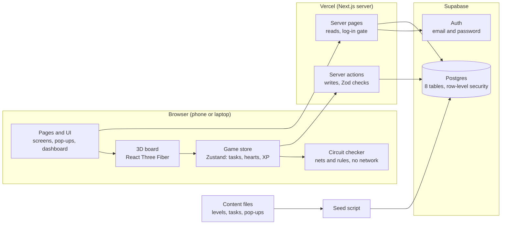
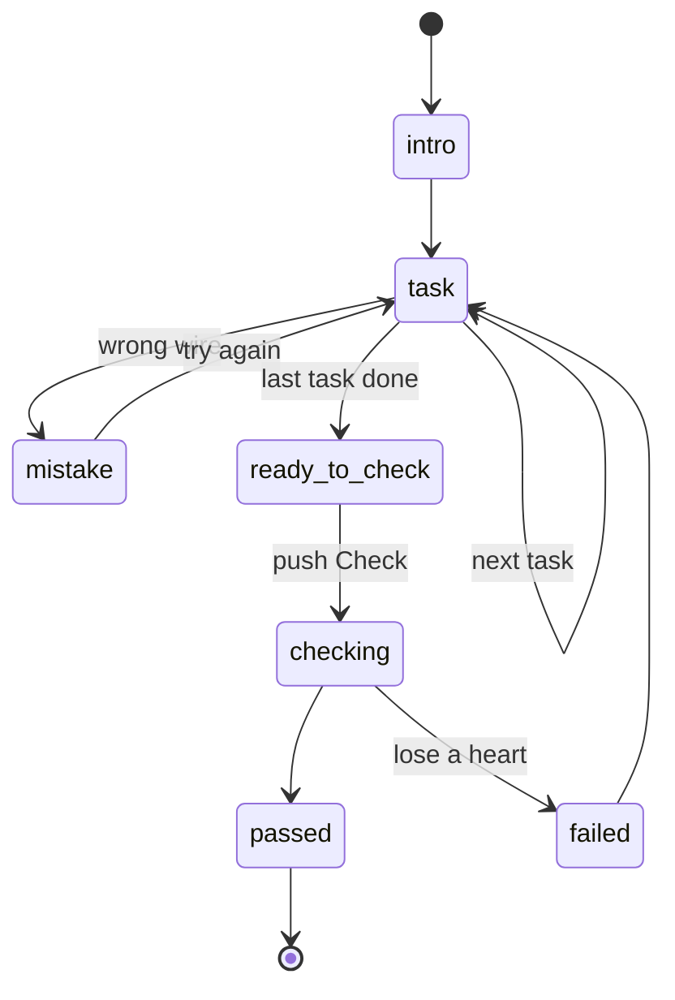
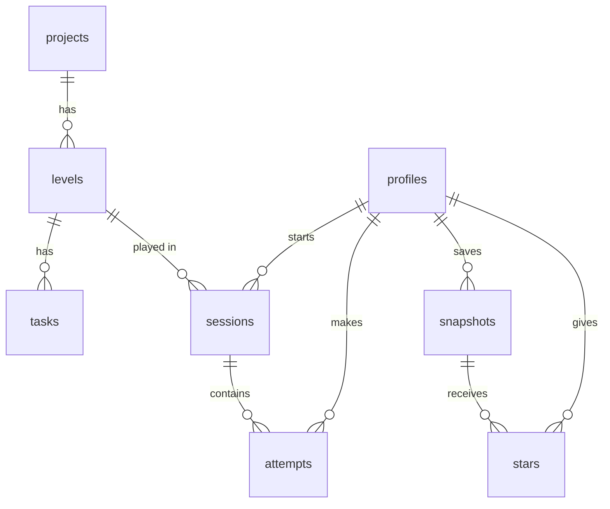

# Jumper: Technical Requirements Document (TRD)

| Item | Value |
| --- | --- |
| Author | Hanif Ramadhan |
| Date | October 15, 2026 |
| Status | Approved for build |
| Writing standard | ASD-STE100 Simplified Technical English |
| Related document | [Product Requirements Document (PRD)](PRD.md) |

## 1. Summary

Jumper is a Next.js app on Vercel. React Three Fiber draws the 3D board in the browser. Supabase gives the log-in function and a Postgres database. This document tells how to build the product in the [PRD](PRD.md).

### 1.1 Key decisions

1. **The circuit checker is a pure TypeScript module.** It does not contain 3D code or database code. It runs in the browser and gives instant feedback. It is easy to test.
2. **Projects, levels and tasks are data, not code.** They are JSON files in the repository. A script loads them into the database. Thus a new project does not need new game code.
3. **Row-level security in Postgres protects each table that users own.** Thus each user sees only their own data, even if the app code has a bug.
4. **Code shapes make the 3D parts.** We use boxes, cylinders and tubes with printed pin labels, as in the prototype. The launch does not need Blender or model files. We can add glTF models later.
5. **One codebase supports laptops and phones.** Touch input for wiring is a primary function.

## 2. Architecture

The browser runs the game and checks each wire immediately. The server reads and writes the database for the user.



- A tap on the 3D board goes to the game store. The store asks the circuit checker after each change.
- Server pages read levels and lists. They also stop users who are not logged in.
- Server actions save sessions, attempts and snapshots.
- The seed script loads the content files from the repository into Postgres.

## 3. Stack

Each layer uses a standard tool with a free tier. Claude Code knows these tools well.

| Layer | Choice | Reason | Alternative that we examined |
| --- | --- | --- | --- |
| Coding agent | Claude Code (Fable for large builds, Opus for plans and reviews) | It works across many files and keeps a clean prompt log for each feature branch. | Replit Agent |
| Framework | Next.js (App Router) with TypeScript | Pages, server code and API are in one project. It works well on Vercel. | Vite and a separate API |
| 3D | three.js through React Three Fiber, with the drei helper library | 3D parts are React components. drei gives camera controls, `Html` pop-ups and glTF loading. | Plain three.js (as in the prototype) |
| Game state | Zustand store | A small, fast store. The 3D scene and the UI both read it. | Redux, XState |
| Styles | Tailwind CSS with design tokens from the prototype | An agent writes it quickly. Tokens keep the light and dark themes the same. | CSS modules |
| UI components | shadcn/ui, on Radix UI and Tailwind CSS | The components go into the repository as source code. Thus we can change them. They give accessible forms, dialogs, sheets and toasts. | Hand-written components |
| Charts | Recharts | Simple React charts for the dashboard | Chart.js |
| Validation | Zod | One schema checks forms and the JSON for wiring and rules. | Checks written by hand |
| Authentication | Supabase Auth, email and password | Users sign up in the app. The live Demo Day sign-up needs this. | Auth.js |
| Database | Supabase Postgres with row-level security | Real tables and foreign keys. The database enforces data isolation. | SQLite and Prisma |
| Hosting | Vercel | Free. It makes a preview URL for each pull request and deploys production when a pull request merges to main. | Replit, Render |
| Tests | Vitest (unit and integration), Playwright (optional end-to-end) | Fast TypeScript tests. Playwright runs a smoke test at phone size. | Jest |
| CI | GitHub Actions | It runs lint and tests on each pull request. | Vercel checks only |
| Browser APIs | Web Audio (mic meter), Speech Synthesis (voice), Vibration (phone haptics, where available) | They make the "It's alive" simulation without other services. | A third-party text-to-speech service |

## 4. App structure

The app has seven routes. Next.js middleware checks the Supabase session. It protects all routes that need a log-in.

| Route | Screen | Log-in necessary |
| --- | --- | --- |
| `/login`, `/signup` | Account forms | No |
| `/lobby` | Project catalog, XP, Continue button, "Coming soon" cards | Yes |
| `/p/[project]` | Level map for one project | Yes |
| `/p/[project]/[level]` | Build mode: 3D board, pop-ups, Check | Yes |
| `/snapshots` | List with search, filters, sort and the Starred view | Yes |
| `/snapshots/[id]` | 3D view of the board (read only), edit notes, delete | Yes |
| `/dashboard` | Stats and the mistakes chart | Yes |

### 4.1 Folders

```
app/            routes above, and server actions in app/actions/
components/
  scene/        Board, Holes, Wire, Part, Module, Esp32S3, PopUp, CameraRig
  ui/           Buttons, Hearts, XpBar, LevelMap, Sheet, Toast
lib/
  circuit/      parts registry, net builder, checker (pure TypeScript)
  game/         Zustand store, task engine, scores
  stats/        dashboard calculations (pure TypeScript)
  supabase/     browser and server clients
content/
  parts/        pin layouts for each part (ESP32-S3, INMP441, MAX98357A, ST7789, LED, ...)
  projects/     perch.json (levels, tasks, pop-up text, sources)
supabase/
  migrations/   SQL for tables and row-level security
  seed.ts       loads content/ into the projects, levels and tasks tables
tests/          unit, integration and end-to-end tests
reference/      breadboard-prototype.html
```

## 5. 3D scene and input

The scene is a React Three Fiber `<Canvas>`. It reads the board from the Zustand store and draws it. The scene does not decide if a wire is correct.

### 5.1 Rendering

- **Breadboards:** Each breadboard is a box with a canvas texture on the top. The texture shows row letters, column numbers and rail lines. The 400 holes of a breadboard are one instanced mesh. Thus more than 800 holes use one draw call for each breadboard.
- **Parts:** Code shapes make all parts. A wire is a tube along a curve. Resistors and LEDs are cylinders with legs. Modules (ESP32-S3, mic, amplifier, screen) are boxes with a printed silkscreen texture. Pin headers go to the positions in the pin layout of the part in `content/parts/`.
- **3D models:** The launch does not need Blender or glTF. If a part needs a detailed model later, export it from Blender, or download it, as glTF. Load it with the `useGLTF` function of drei. The pin layout file continues to set the pin positions.
- **Render on demand:** The canvas draws again only when a change occurs (`frameloop="demand"`). This saves battery power on phones.

### 5.2 Selection and input

- The app separates a tap or click from a camera drag. A tap moves less than 6 px and takes less than 600 ms.
- A ray from the pointer hits the board plane. The app selects the nearest hole within half of the hole pitch.
- **Laptop:** Drag with the left button to turn the board. Drag with the right button to move it. Scroll to zoom. When the pointer is on a hole, all holes in the same connection glow.
- **Phone:** Drag with one finger to turn the board. Pinch with two fingers to zoom and move. Phones do not have a hover state. Thus the first tap on a hole shows its connections and selects it. Tap targets are larger. The camera zooms to the selected hole automatically.
- A flat top-down camera is always available as a fallback. It uses the same scene and data.

### 5.3 Pop-ups

- **Laptop:** The drei `Html` component attaches the pop-up to the target pin in 3D, with a line to the pin. The target holes glow.
- **Phone:** The pop-up is a sheet at the bottom of the screen. Thus it does not cover the board. The target holes continue to glow.
- The pop-up text comes from the task record (`instruction`, `popup_why`, `concept`). Do not write pop-up text in the code.

## 6. Build-mode engine and circuit checker

The engine is a small state machine in the Zustand store. The checker is a set of pure functions. The engine calls the checker after each change.

### 6.1 Engine states



Each transition updates the counters of the session: tasks done, mistakes and XP.

### 6.2 How the checker works

1. Each breadboard defines which holes connect. Each half-column of 5 holes is one strip. Each rail is one strip along its full length.
2. Each part on the board maps its pins to holes. It uses its pin layout. For example, the `WS` pin of the mic goes to hole `B-c14`.
3. Wires join strips with a union-find algorithm. The result is a list of **nets**. A net is a group of holes that have an electrical connection.
4. A **task** passes when its target connection exists. For example, the mic `WS` pin and the ESP32 `GPIO4` pin are on the same net.
5. The checker compares a wrong wire with the **forbid** rules of the level. Examples are a short to ground, power to power, and a reversed LED. The result selects the text of the Mistake pop-up.
6. The **level check** passes when all `require` rules are true and no `forbid` rule is true.

### 6.3 Data formats

Zod validates these formats.

```jsonc
// snapshot.wiring
{
  "boards": ["bb400-A", "bb400-B"],
  "parts": [{ "id": "mic1", "type": "inmp441", "at": "B-c12", "rot": 0 }],
  "wires": [{ "id": "w1", "from": "B-a14", "to": "A-a8", "color": "#D63A2F" }]
}

// level.rules
{
  "require": [{ "a": "esp.GPIO4", "b": "mic1.WS" }, { "a": "mic1.VDD", "b": "esp.3V3" }],
  "forbid":  [{ "a": "esp.3V3", "b": "esp.GND", "code": "short_power" }]
}

// task.target
{ "kind": "wire", "a": "mic1.WS", "b": "esp.GPIO4" }
{ "kind": "place", "part": "inmp441", "zone": "bb400-B" }
```

The checker reads only these formats. Thus a new project needs new JSON files, but no new engine code.

## 7. Database schema

Postgres has eight tables. Three tables contain shared content. Five tables contain the data of each user, behind row-level security. Supabase keeps the accounts in `auth.users`. The `profiles` table adds data to each account.

| Table | Columns (type) | Keys | Read and write access |
| --- | --- | --- | --- |
| profiles | id (uuid), display_name (text), xp (int, default 0), created_at (timestamptz) | PK id = auth.users.id | Owner only |
| projects | id (int), slug (text, unique), title (text), tagline (text), board (text), status (text: available or coming_soon), position (int) | PK id | All users read. The seed script writes. |
| levels | id (int), project_id (int), position (int), title (text), goal (text), rules (jsonb), xp (int) | PK id. FK project_id → projects | All users read. The seed script writes. |
| tasks | id (int), level_id (int), position (int), kind (text: place or wire), instruction (text), popup_why (text), concept (text, nullable), target (jsonb), source_url (text), xp (int) | PK id. FK level_id → levels | All users read. The seed script writes. |
| sessions | id (uuid), user_id (uuid), level_id (int), status (text: in_progress, completed or abandoned), started_at (timestamptz), ended_at (timestamptz), tasks_done (int), mistakes (int), xp_earned (int) | PK id. FKs to profiles and levels | Owner only |
| attempts | id (uuid), user_id (uuid), session_id (uuid), level_id (int), passed (bool), mistake_type (text, nullable), created_at (timestamptz) | PK id. FKs to profiles, sessions and levels | Owner only |
| snapshots | id (uuid), user_id (uuid), level_id (int), session_id (uuid, nullable), title (text, not null), notes (text), wiring (jsonb), passed (bool), mistake_count (int), created_at (timestamptz), updated_at (timestamptz) | PK id. FKs to profiles, levels and sessions | Owner only |
| stars | user_id (uuid), snapshot_id (uuid), created_at (timestamptz) | PK (user_id, snapshot_id). FKs to profiles and snapshots | Owner only |



**Row-level security.** Each table that users own has the same policy for select, insert, update and delete: `user_id = auth.uid()`. For `profiles`, the policy is `id = auth.uid()`. Content tables let all users select. The app cannot write to content tables. The isolation test proves that these policies work.

**Session status rule.** A session changes to `completed` only in the same transaction that records a level attempt that passed. If a session stays `in_progress` for more than 2 hours, the app sets it to `abandoned` when the user opens the app again.

## 8. Key flows

From the start of a level to a saved snapshot, the browser does the checks. The server records only the data that must persist.

### 8.1 Play a level

1. The learner opens `/p/perch/3`. The page loads the level, its tasks and the progress of the user on the server. Then the page gives this data to the scene.
2. The browser calls `startSession(levelId)`. The server adds a `sessions` row with the status `in_progress`.
3. For each task, the browser shows the pop-up. The learner puts a part or connects a wire. The checker gives the result immediately, without a network call.
4. After some tasks, and when the learner leaves the page, the browser calls `updateSession`. It sends the tasks done, the mistakes and the XP.
5. When the learner pushes **Check**, the browser does the level check. Then it calls `recordAttempt(sessionId, passed, mistakeType)`.
6. If the check passed, the server does three things in one transaction. It adds the attempt, sets the session to `completed`, and adds XP to the profile. If the check failed, the server adds only the attempt. The learner continues to connect wires.
7. On the Level complete screen, **Save snapshot** calls `createSnapshot` with the title, the notes and the wiring JSON of the board.

### 8.2 Other flows

- **Lobby:** The page reads the projects and the latest session of the user. The latest session sets the Continue button.
- **Snapshots:** One Postgres query does the list, search, filter and sort. The search uses `ilike` on the title and the notes.
- **Dashboard:** The server gets the attempts and sessions of the user. Pure functions in `lib/stats/` calculate levels completed, completed sessions, XP, first-try pass rate and mistakes by type.

## 9. Server actions

All writes go through Next.js server actions. These actions use the Supabase client of the user who is logged in. Thus row-level security applies to each call. Zod validates all inputs. If an error occurs, the action returns a clear message for the UI.

| Action | Input | Writes | Used by |
| --- | --- | --- | --- |
| `signUp`, `logIn`, `logOut` | Email, password, display name | auth.users, profiles | Account forms |
| `startSession` | Level ID | sessions (new row, in_progress) | Build mode |
| `updateSession` | Session ID, tasks done, mistakes, XP | sessions | Build mode |
| `recordAttempt` | Session ID, passed, mistake type | attempts. If the check passed, also sessions (completed) and profiles.xp | Level check |
| `createSnapshot` | Level ID, session ID, title, notes, wiring | snapshots | Level complete, build mode |
| `updateSnapshot` | ID, title, notes | snapshots | Snapshot page |
| `deleteSnapshot` | ID | snapshots (the database removes its stars automatically) | Snapshot page |
| `toggleStar` | Snapshot ID | stars (add or remove) | Snapshot list and snapshot page |

Server components do the reads with the same client: `getProjects`, `getLevel` (with tasks), `listSnapshots` (search, filter, sort), `getSnapshot` and `getDashboardData`.

## 10. Tests and CI

Vitest runs the two required tests on each pull request. The checker and the stats functions are pure functions. Thus they also get unit tests.

| Test | Type | What it proves | Method |
| --- | --- | --- | --- |
| Data isolation (required) | Integration | User B cannot see the snapshot of User A, in a list or by ID. | Use two test accounts in a separate Supabase **test project**. User A makes a snapshot. The `listSnapshots` result of User B is empty. `getSnapshot` with the ID of User A returns "not found". |
| First-try pass rate (required) | Unit | 3 levels with first attempts pass, fail and pass give 67%. | Call `firstTryPassRate()` in `lib/stats/` with fixed attempts. |
| Checker | Unit | Correct wiring passes. The checker finds shorts, reversed LEDs and wrong pins, and gives the correct mistake code. | Use fixed wiring JSON for each case. |
| Session status | Unit | A session is completed only after all tasks and a level check that passes. | Send fixed events to the engine and check the transitions. |
| Phone smoke test (optional) | End-to-end | A new user can sign up and complete Level 1 at phone size. | Playwright at 390 × 844 |

**Red, then green.** Do these steps in the pull request of each required test:

1. Tell Claude Code to break the feature temporarily. For example, remove the row-level security policy, or count retries in the pass rate.
2. Run the test. Record a screenshot of the failure.
3. Remove the break.
4. Run the test again. Record a screenshot of the pass.

**CI.** A GitHub Actions workflow runs the type check, lint and Vitest on each pull request. GitHub Actions secrets keep the keys of the test project. Do not put keys in the repository.

## 11. Deployment and environments

Jumper uses four environments. All use free tiers.

| Environment | App | Database | When it updates |
| --- | --- | --- | --- |
| Local | `npm run dev` on the laptop of the developer | Supabase **dev** project | When you save a file |
| Preview | A Vercel preview URL for each pull request | Supabase **dev** project | At each push to a feature branch |
| Production | The Vercel production URL (the live app link) | Supabase **prod** project | At each merge to `main` |
| Tests and CI | GitHub Actions | Supabase **test** project | At each pull request |

- **Database changes:** Write SQL files in `supabase/migrations/`. Apply them with the Supabase CLI. Each schema change is a separate pull request. Apply it to production immediately after the merge.
- **Content:** `supabase/seed.ts` loads `content/projects/*.json`. When you run it again, it updates projects, levels and tasks. It does not change user data.
- **Secrets:** Vercel keeps `NEXT_PUBLIC_SUPABASE_URL` and `NEXT_PUBLIC_SUPABASE_ANON_KEY` for each environment. Only the seed script and CI use the service-role key. Do not send the service-role key to the browser.
- **Branch protection:** `main` requires a pull request. This agrees with the assignment rule: no direct commits to main.

## 12. Performance, phone support and open questions

The target is a smooth board on a mid-range phone. A level must become interactive in less than 3 seconds on 4G. The board must not stop or jump when it turns.

### 12.1 Limits and methods

- **Draw calls:** The holes are instanced, with one draw call for each breadboard. Parts share materials.
- **Frame work:** The canvas draws only when a change occurs. The app calculates nets again only when a wire or a part changes. It does not calculate them on each frame.
- **Pixel ratio:** The maximum is 2. On phones, it decreases to 1.5 if the frame rate is less than 50 frames per second.
- **Load size:** Only the build-mode pages and snapshot pages load the 3D scene. Thus the lobby and the dashboard load quickly.
- **Phone layout:** The board fills the screen. The tools go into a toolbar at the bottom. Pop-ups become a sheet at the bottom. Buttons are a minimum of 44 px high.
- **Fallback:** A flat top-down view uses the same scene without rotation. Use it on slow devices or if the user prefers it.

### 12.2 Open technical questions

| Question | Current answer | Decide by |
| --- | --- | --- |
| Can the learner put modules with many pins on the board with a tap on a phone? | Make a prototype first. Tap a module in the parts tray. Then tap the hole for its pin 1. | Before feature 4 |
| Do we keep the wiring as JSON, or as rows in a wires table? | JSON in the snapshot. It is simpler, and the checker reads it directly. | Plan pull request |
| Must the server do the level check again before it records a pass? | Not for the launch. The checker runs in the browser. The shared module lets the server check later. | After the launch |
| Do we use code shapes or glTF models for detailed parts? | Code shapes for the launch. Use glTF (exported from Blender, or downloaded) only if a part looks wrong. | After Level 3 |
