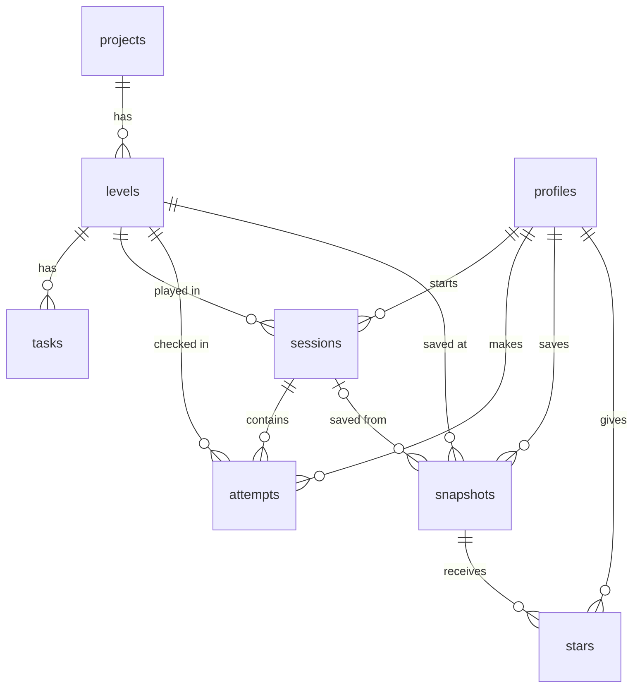

# Database schema

This file lists each table in the Jumper database, its columns and its relations. It also compares the built schema with section 3 of [PLAN.md](PLAN.md).

- SQL: [supabase/migrations/20261018000000_data_model.sql](supabase/migrations/20261018000000_data_model.sql) (tables), [supabase/migrations/20261018100000_level_check.sql](supabase/migrations/20261018100000_level_check.sql) (the `record_attempt` function) and [supabase/migrations/20261019000000_profile.sql](supabase/migrations/20261019000000_profile.sql) (the profile character, and the profile columns that a user can change)
- Content that fills the content tables: [content/projects/](content/projects/), loaded by [supabase/seed.ts](supabase/seed.ts) (`npm run seed`)
- Source of truth for the design: [TRD section 7](docs/TRD.md#7-database-schema)

## Tables

The database has eight tables. Three tables contain shared content. Five tables contain the data of each user.

### Content tables

All logged-in users can read these tables. The app cannot write to them. Only the seed script writes to them, with the secret key.

**projects**: one row for each project in the catalog.

| Column | Type | Notes |
| --- | --- | --- |
| id | int | Primary key, generated |
| slug | text | Unique. For example `perch` |
| title | text | |
| tagline | text | What the project teaches |
| board | text | For example `ESP32-S3` |
| status | text | `available` or `coming_soon` |
| position | int | Order in the catalog |

**levels**: the levels of a project, in sequence.

| Column | Type | Notes |
| --- | --- | --- |
| id | int | Primary key, generated |
| project_id | int | Foreign key → projects.id. Unique with position |
| position | int | 1, 2, 3… |
| title | text | |
| goal | text | |
| rules | jsonb | `{ require: [{a, b}], forbid: [{a, b, code, message}] }`. The level check reads it. |
| xp | int | Bonus XP for the level |

**tasks**: the tasks of a level, in sequence. Each task has one pop-up.

| Column | Type | Notes |
| --- | --- | --- |
| id | int | Primary key, generated |
| level_id | int | Foreign key → levels.id. Unique with position |
| position | int | 1, 2, 3… |
| kind | text | `place` or `wire` |
| instruction | text | What to do |
| popup_why | text | Why, shown in the pop-up |
| concept | text, nullable | Concept pop-up text, only when the task introduces an idea |
| target | jsonb | `{kind: "wire", a, b}` or `{kind: "place", part, id, zone}` |
| source_url | text | The source of the "why" |
| xp | int | XP for the task |

### User tables

Row-level security protects these tables. Each user can select, insert, update and delete only their own rows (`user_id = auth.uid()`; for profiles, `id = auth.uid()`). For profiles there is one more limit: a user can only read their row and change `display_name` and `avatar`. Only the sign-up trigger adds a profile, and only `record_attempt` changes `xp`.

**profiles**: one row for each account. A trigger adds the row when a user signs up. The migration also adds rows for accounts that existed before it.

| Column | Type | Notes |
| --- | --- | --- |
| id | uuid | Primary key. Foreign key → auth.users.id |
| display_name | text, nullable | From sign-up data, or the part of the email before the @ |
| xp | int | Default 0. Only `record_attempt` changes it |
| avatar | text | The character of the profile picture: `volt`, `diode`, `pixel`, `servo` or `chip` (the ids in `content/ui/avatars.json`). Default `volt` |
| created_at | timestamptz | |

**sessions**: one sitting on a level.

| Column | Type | Notes |
| --- | --- | --- |
| id | uuid | Primary key |
| user_id | uuid | Foreign key → profiles.id |
| level_id | int | Foreign key → levels.id |
| status | text | `in_progress`, `completed` or `abandoned` |
| started_at | timestamptz | |
| ended_at | timestamptz, nullable | |
| tasks_done | int | |
| mistakes | int | |
| xp_earned | int | |

**attempts**: each push of Check.

| Column | Type | Notes |
| --- | --- | --- |
| id | uuid | Primary key |
| user_id | uuid | Foreign key → profiles.id |
| session_id | uuid | Foreign key → sessions.id |
| level_id | int | Foreign key → levels.id |
| passed | boolean | |
| mistake_type | text, nullable | Empty when the attempt passed. Else a forbid rule code (for example `short_power`, `reversed_led`), `missing_ground` or `wrong_pin` |
| created_at | timestamptz | |

**snapshots** (main item): a saved board.

| Column | Type | Notes |
| --- | --- | --- |
| id | uuid | Primary key |
| user_id | uuid | Foreign key → profiles.id |
| level_id | int | Foreign key → levels.id |
| session_id | uuid, nullable | Foreign key → sessions.id |
| title | text | Must not be empty |
| notes | text | |
| wiring | jsonb | The board: `{ "version": 1, "parts": [...] }`. The parts and wires use the same format as `content/boards/` (issue #23) |
| passed | boolean | |
| mistake_count | int | |
| created_at | timestamptz | |
| updated_at | timestamptz | A trigger sets it at each edit |

**stars**: the snapshots that a user starred.

| Column | Type | Notes |
| --- | --- | --- |
| user_id | uuid | Primary key with snapshot_id. Foreign key → profiles.id |
| snapshot_id | uuid | Foreign key → snapshots.id |
| created_at | timestamptz | |

A user can star only their own snapshots. The policy checks this, because a foreign key check does not use row-level security.

## Functions

**record_attempt**(session, passed, mistake_type, tasks_done, mistakes, task_xp) → `{ completed, fails }`. The level Check calls it (issue #25). It runs as its owner (`security definer`), because users cannot write `profiles.xp` (feature 17). It finds only the session of the user who calls it (`user_id = auth.uid()`), and it writes only that session, its attempt and the profile of that user.

- A failed Check: it adds one row to `attempts`, with the mistake type.
- A passed Check, in one transaction: it adds the attempt, sets the session to `completed` with `ended_at`, and sets `xp_earned` to the task XP + the level XP + 10 XP when the session has no mistakes and no failed Check. Then it adds `xp_earned` to `profiles.xp`.
- A pass needs all the tasks of the level done. The task XP cannot be more than the sum of the task XP of the level.
- A second Check on a completed session changes nothing.
- `fails` is the number of failed Checks in the session. The app shows hearts from it: 3 − fails, and at 0 hearts the next fail gives 3 new hearts.

## Relations

- One project has many levels. One level has many tasks.
- One user has many sessions, attempts and snapshots. One session has many attempts.
- Users and snapshots have a many-to-many relation through stars.
- When an account is deleted, its profile and all its rows are deleted (cascade). When a snapshot is deleted, its stars are deleted. When a session is deleted, its snapshots stay, with an empty `session_id`.

## Comparison with PLAN.md section 3

| PLAN.md section 3 | Built | Why |
| --- | --- | --- |
| `users` table | `profiles` table, with `id` → `auth.users.id` | Supabase Auth keeps the accounts in `auth.users`. `profiles` adds our data to each account (TRD section 7). |
| `users.id` (text) | `profiles.id` (uuid) | Supabase account IDs are UUIDs. |
| — | `profiles.xp` (int) | The lobby shows the XP of the user. One column is faster than a sum of all sessions. |
| — | `profiles.avatar` (text) | The profile picture (PLAN.md feature 17, Plan vs. Reality). A learner selects one of 5 characters. The images are in `public/avatars/`. |
| `steps` table | `levels` table | The app and the PRD call them levels. |
| `step_id` columns | `level_id` columns | Same as above. |
| `projects.id`, `steps.id`, `tasks.id` (number) | int, generated | Same meaning. The database makes the numbers. |
| `rules`, `target`, `wiring` (text, JSON) | jsonb | Postgres can check and query jsonb. |
| — | `tasks.source_url` (text) | Each pop-up gives a source, so that the app does not teach an incorrect fact (PLAN.md section 7). |
| — | `levels.rules.forbid[].message` | The Mistake pop-up text is content, not code (house rule 7). |
| `snapshots.id`, `sessions.id`, `attempts.id` (text) | uuid | The database makes random IDs. |
| — | `snapshots.session_id` (uuid, nullable) | A snapshot can link to the session that made it (TRD section 7). |
| `wiring` as in TRD 6.3 (`boards`, `parts`, `wires`) | `{ version, parts }`, with wires as parts (`type: "wire"`) | The bench and `content/boards/` use this format. Thus the snapshot page opens the board with no conversion (issue #23). |
| `stars` | Same columns | Plus the rule that a user stars only their own snapshots. |
| Content "readable by everyone" | Readable by logged-in users only | All app pages need a log-in (issue #11). |
| `created_at` (date) | timestamptz | The dashboard needs the time, not only the date. |
| Hearts (PLAN.md section 2) | No column. Hearts come from the failed attempts of the session | One source of truth. A failed Check already saves an attempt (issue #25). |
